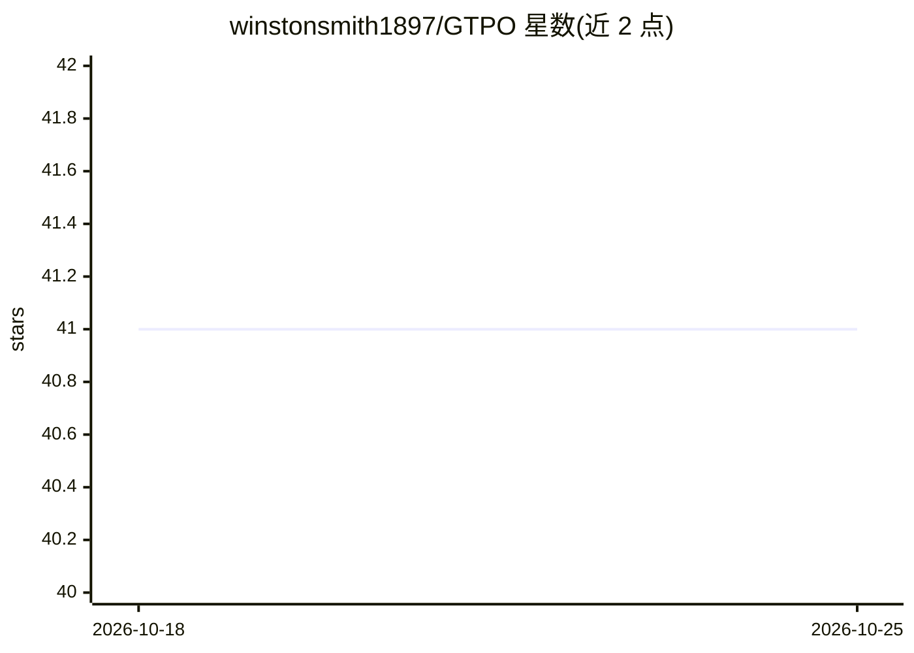

# winstonsmith1897/GTPO

⭐ 41 · Jupyter Notebook · 推送 2026-02-23 · [GitHub](https://github.com/winstonsmith1897/GTPO) · 组织维护

**面向 LLM 的 GTPO 强化学习训练方法官方实现**

GTPO（Group-relative Trajectory-based Policy Optimization）的官方 PyTorch 实现，论文作者来自学术界团队。方法在 GRPO 基础上引入冲突感知梯度修正（保护正负奖励样本中共现的冲突 token）与基于熵的正则化（过滤高熵不稳定样本），训练时不需 KL 散度正则与参考模型。以 train_model.py 为单一入口，从 YAML 配置加载模型/数据集/训练器/奖励函数，支持 CLI 覆盖，基于 Unsloth 补丁运行，保存 LoRA 适配器；提供 GSM8K 与 Hendrycks MATH 数据集配方及 Colab 演示笔记本。实验在 LLaMA-8B 与 Qwen 2.5-3B 上进行。

## 筛选速览

| 维度 | 判定 | 备注 |
|---|---|---|
| AI 角色 | `ai-ecosystem` | LLM/agent 周边工具 |
| 许可风险 | `permissive` | — |
| 部署形态 | `library` | 以包/库形式分发 |
| 模型依赖 | — | README 未给出锁定关系 |
| 硬件要求 | — | 无带数字的原话,不猜 |
| 安装摩擦 | `medium` | 含编译或系统依赖之一 |
| 成熟度 | — | 结构信号不足 |

## 能力要点

- 冲突感知梯度修正：识别并保护正负奖励完成中共现的冲突 token
- 基于熵的正则化过滤高熵不稳定样本，防止策略崩溃
- 无需参考模型与 KL 散度正则
- YAML 配置 + CLI 覆盖的单一入口训练脚本，训练器与奖励函数按虚线路径动态导入

## 适用场景

- 我需要对 LLM 做 GRPO 类后训练并缓解梯度冲突与策略崩溃
- 我在 GSM8K/MATH 等数学推理数据集上训练 LoRA 适配器
- 我想在 Colab 上快速复现论文训练流程

## 场景标签

`微调` `强化学习` · 领域:训练与推理

## 证据(README 行号)

> L15: This repository contains the official implementation of **GTPO (Group-relative Trajectory-based Policy Optimization
> L21: GTPO introduces **conflict-aware gradient corrections** and **entropy-based regularization** to mitigate these issu

## 星数曲线

2026-10-18 41 → 2026-10-25 41（+0）

---
*卡片 v1 · prompt 1.4 · 生成 2026-10-18 · 置信度 mid · 依据 README sha `bde146d11d69` · [字段定义](../../DATASET.md)*
