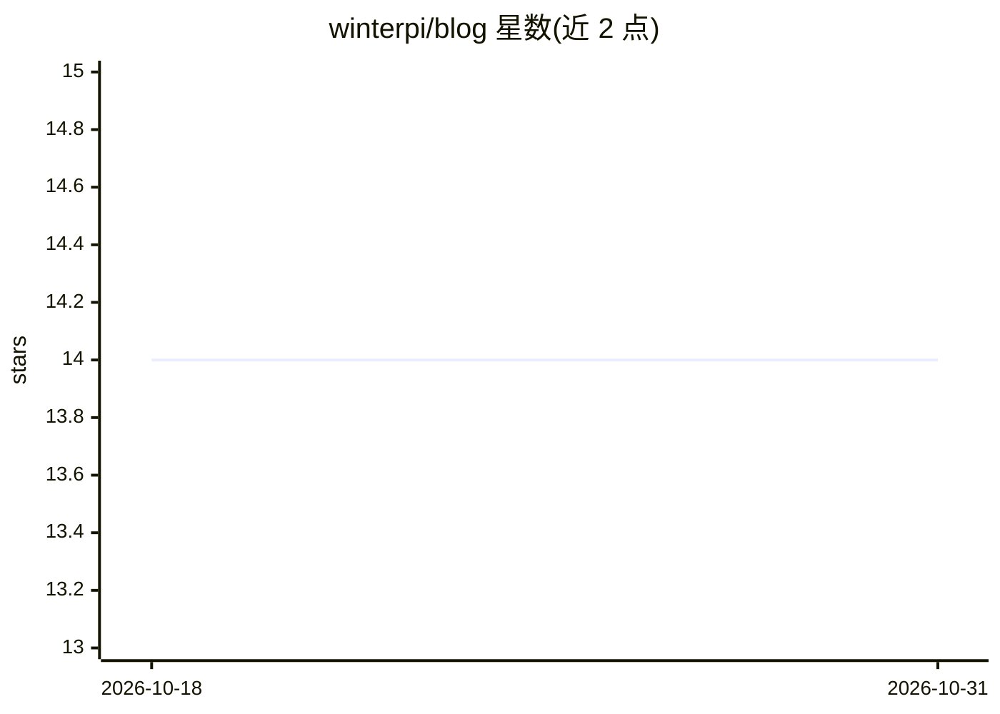

# winterpi/blog

⭐ 14 · 推送 2026-10-16 · [GitHub](https://github.com/winterpi/blog) · 个人维护 · 中文 README

**个人技术博客：AI、区块链、密码学文章目录与随笔**

winter pi 的个人博客仓库，以文章目录形式组织内容：LLM 与深度学习系列解读（含 LangChain、RAG、大模型训练微调、论文阅读）、区块链与 Hyperledger 系列、密码学与隐私计算/安全多方计算系列，另含数据交易、工程技术、个人随笔、读书笔记、社会科技解读，以及参与翻译校验的 Hyperledger 文章列表。仓库提供文章索引，正文托管于外部博客平台，早前文章迁移自简书专栏。

## 筛选速览

| 维度 | 判定 | 备注 |
|---|---|---|
| AI 角色 | `ai-knowledge` | 知识聚合/清单类 |
| 许可风险 | `none` | — |
| 部署形态 | `None` |  |
| 模型依赖 | — | README 未给出锁定关系 |
| 硬件要求 | — | 无带数字的原话,不猜 |
| 安装摩擦 | `low` | 无编译、无系统依赖或容器化 |
| 成熟度 | — | 结构信号不足 |

## 能力要点

- LLM 相关解读文章 40+ 篇（RAG、训练微调、论文阅读、Agent）
- 区块链/密码学/隐私计算/安全多方计算系列技术文章
- 参与翻译与校验的 Hyperledger 官方文章与书籍列表
- 附个人随笔、读书笔记与社会科技解读内容

## 适用场景

- 查找 LLM、RAG、大模型训练方向的中文入门解读
- 了解区块链、密码学与隐私计算的技术文章脉络
- 阅读 Hyperledger 相关中文翻译资料线索

## 场景标签

 · 领域:技术博客/知识记录

## 证据(README 行号)

> L8: - LLM论文阅读（持续更新）
> L53: - 区块链相关1--何为稳定币
> L69: - 密码学相关1--国密算法

## 星数曲线

2026-10-18 14 → 2026-10-31 14（+0）

---
*卡片 v1 · prompt 1.4 · 生成 2026-10-31 · 置信度 high · 依据 README sha `da28feceba81` · [字段定义](../../DATASET.md)*
