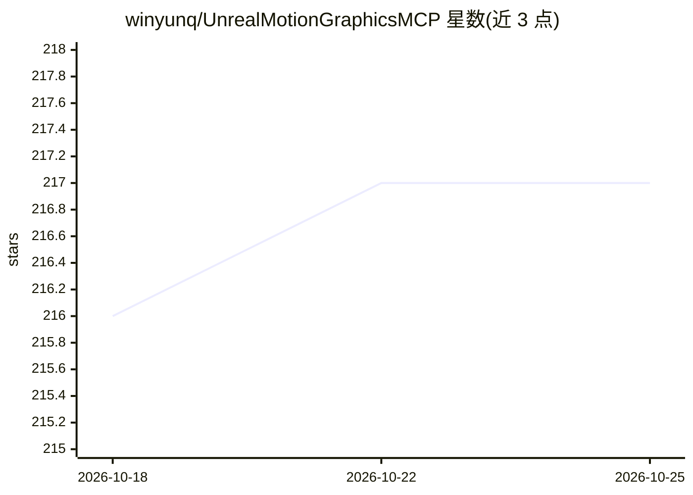

# winyunq/UnrealMotionGraphicsMCP

⭐ 217 · C++ · MIT · 推送 2026-08-02 · [GitHub](https://github.com/winyunq/UnrealMotionGraphicsMCP) · [官网](https://winyunq.github.io/UnrealMotionGraphicsMCP/) · 个人维护 · 中文 README

**面向 UE5 UMG 界面的 MCP 插件：AI agent 读写界面结构与蓝图**

Unreal Engine 5.8 Win64 的编辑器插件，通过 MCP 工具与 Python 服务器让外部 AI agent 操作 UMG：创建/重构 widget 树并以 JSON 往返导入导出，经 BlueCode 命令创建蓝图节点与连线，编辑材质参数与 HLSL，驱动 UMG 动画轨道与关键帧。多编辑器实例通过发现注册表选择端口。提供 Fab Marketplace 打包版与源码版两种安装路径，模型提供商支持 Gemini API、Google OAuth、ZhipuAI 及 OpenAI 兼容端点。蓝图 API 处于过渡状态，嵌套分支/循环等完整结构化编辑列为 v2 工作。

## 筛选速览

| 维度 | 判定 | 备注 |
|---|---|---|
| AI 角色 | `ai-ecosystem` | LLM/agent 周边工具 |
| 许可风险 | `permissive` | MIT |
| 部署形态 | `library` | 以包/库形式分发 |
| 模型依赖 | — | README 未给出锁定关系 |
| 硬件要求 | — | 无带数字的原话,不猜 |
| 安装摩擦 | `low` | 无编译、无系统依赖或容器化 |
| 成熟度 | `idea` | |

## 能力要点

- UMG widget 树可导出/打补丁/重应用为结构化 JSON
- BlueCode 命令直接创建蓝图节点、引脚与连线，支持干运行与失败回滚
- 材质参数与 HLSL 片段编辑、UMG 动画轨道与关键帧操作
- 多编辑器实例经发现注册表按端口选择连接

## 适用场景

- 让 AI agent 按自然语言指令搭建 UE5 登录面板等 UMG 界面
- 把 UMG 界面文件转为 JSON 做 diff 与版本管理
- 通过 MCP 客户端在编辑器外自动化界面与蓝图修改

## 场景标签

`Agent 框架` · 领域:Agent 开发

## 证据(README 行号)

> L18: UMG MCP turns Unreal Editor UMG work into explicit, reviewable tool calls. An AI agent can create widgets, update l
> L70: External MCP clients use the Python server under `Resources/Python`. Each Unreal Editor instance binds an OS-assign

## 星数曲线

2026-10-18 216 → 2026-10-25 217（+1）

---
*卡片 v1 · prompt 1.4 · 生成 2026-10-22 · 置信度 mid · 依据 README sha `59a7f2a9b00e` · [字段定义](../../DATASET.md)*
