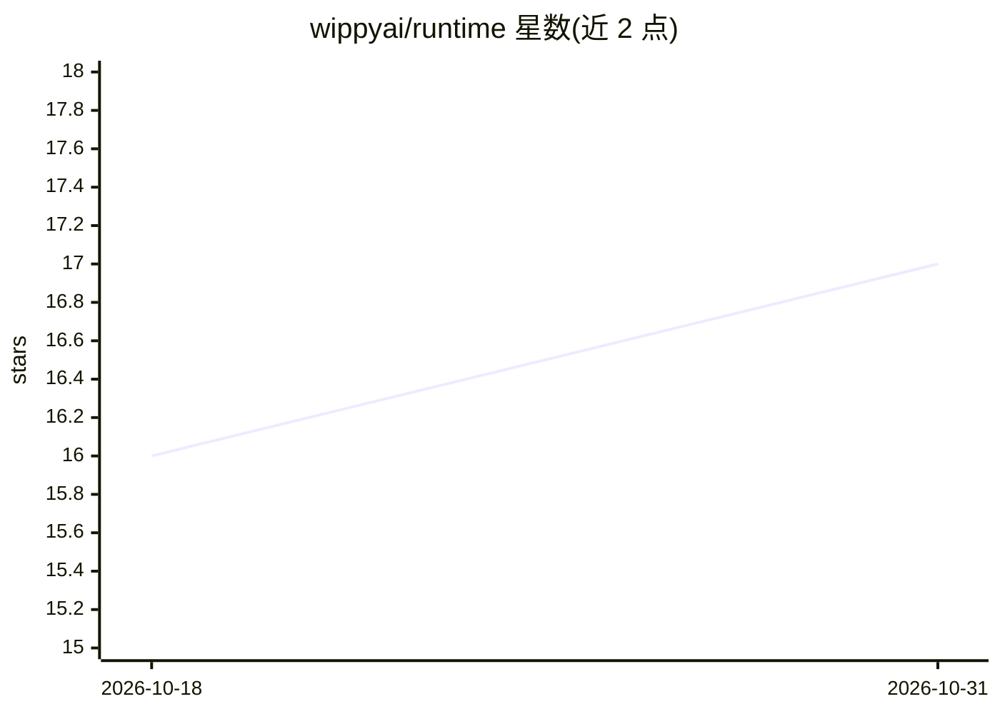

# wippyai/runtime

⭐ 17 · Go · MPL-2.0 · 推送 2026-10-30 · [GitHub](https://github.com/wippyai/runtime) · [官网](https://wippy.ai/) · 组织维护

**开源 actor 模型运行时，用于构建复杂应用与 agent 系统**

以 Go 编写、以 Lua 脚本为应用代码的 actor 模型运行时：进程隔离、监督树、消息传递，内置持久化工作流、队列、调度、缓存、向量搜索与集群能力，减少外部基础设施拼装。支持 ABAC 安全策略、版本化组件热更新回滚、SQL/KV 存储与 OpenTelemetry 可观测性；应用可由团队或 AI agent 经 MCP 在运行时更新而无需重新部署。要求 Go 1.26+，从源码克隆编译生成 wippy CLI 后初始化、安装依赖并运行。

## 筛选速览

| 维度 | 判定 | 备注 |
|---|---|---|
| AI 角色 | `ai-ecosystem` | LLM/agent 周边工具 |
| 许可风险 | `permissive` | MPL-2.0 |
| 部署形态 | `None` |  |
| 模型依赖 | — | README 未给出锁定关系 |
| 硬件要求 | — | 无带数字的原话,不猜 |
| 安装摩擦 | `low` | 无编译、无系统依赖或容器化 |
| 成熟度 | — | 结构信号不足 |

## 能力要点

- Erlang 式监督树与消息传递的隔离 Lua 进程模型
- 内置向量搜索（SQLite/Postgres）支持 embeddings 与 RAG
- Raft 共识与 SWIM gossip 组成的集群模式
- 应用可经 MCP 由 AI agent 在运行时更新，无需重部署

## 适用场景

- 在同一运行时内构建 agent 系统而免于拼装多个基础设施服务
- 需要热更新、回滚与版本化组件管理的长时运行应用
- 跨节点部署具备分布式锁与位置透明进程的集群应用

## 场景标签

`Agent 框架` · 领域:Agent 开发

## 证据(README 行号)

> L13: Wippy is an open-source, actor-model runtime for building complex applications and agent systems - without the stac
> L17: Each process is sandboxed to the capabilities you grant it, your data stays on infrastructure you own, and every ch

## 星数曲线

2026-10-18 16 → 2026-10-31 17（+1）

---
*卡片 v1 · prompt 1.4 · 生成 2026-10-30 · 置信度 high · 依据 README sha `ba1340fb58d8` · [字段定义](../../DATASET.md)*
