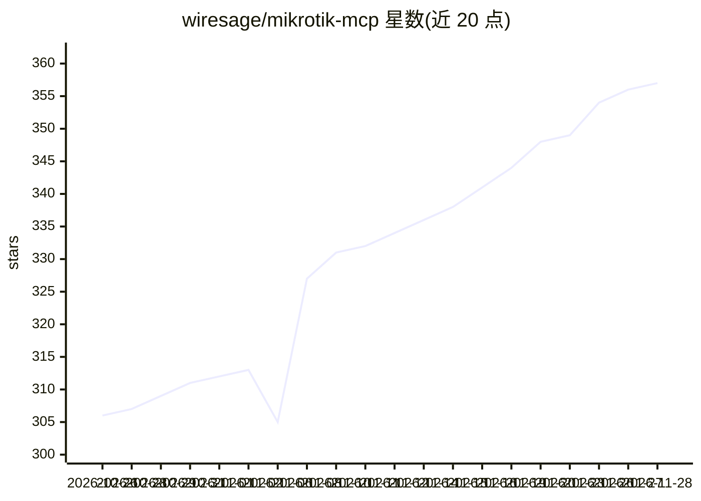

# wiresage/mikrotik-mcp

⭐ 357 · Python · MIT · 推送 2026-11-27 · [GitHub](https://github.com/wiresage/mikrotik-mcp) · [官网](https://mikrotik-mcp.com) · 组织维护

**让 AI 助手用自然语言管理 MikroTik RouterOS 路由器的 MCP 服务器**

在 AI 助手与 MikroTik RouterOS 设备之间提供桥接：助手通过自然语言请求执行操作，包括管理 VLAN、配置防火墙规则、处理 DNS 设置等。自 0.14.0 版本起支持通过 inventory 结构管理多台 MikroTik 设备。README 提供 Claude Desktop 与 Claude Code 的集成配置指引、MCP Inspector 交互测试，附演示视频、完整文档站点与单元/集成测试指南，MIT 许可发布。

## 筛选速览

| 维度 | 判定 | 备注 |
|---|---|---|
| AI 角色 | `ai-ecosystem` | LLM/agent 周边工具 |
| 许可风险 | `permissive` | MIT |
| 部署形态 | `None` |  |
| 模型依赖 | — | README 未给出锁定关系 |
| 硬件要求 | — | 无带数字的原话,不猜 |
| 安装摩擦 | `low` | 无编译、无系统依赖或容器化 |
| 成熟度 | — | 结构信号不足 |

## 能力要点

- 将 AI 助手自然语言请求转换为 RouterOS 操作（VLAN、防火墙、DNS 等）
- 0.14.0 起支持 fleet 结构管理多台 MikroTik 设备
- 提供 Claude Desktop / Claude Code 集成配置与 MCP Inspector 测试指引

## 适用场景

- 让 Claude Desktop 对话式管理路由器的 VLAN 与防火墙规则
- 通过设备 inventory 让 LLM 批量操作多台 MikroTik 设备
- 用 MCP Inspector 交互测试服务器的工具调用

## 场景标签

 · 领域:网络运维/AI 工具集成

## 证据(README 行号)

> L14: MikroTik MCP provides a bridge between AI assistants and MikroTik RouterOS devices. It allows AI assistants to inte
> L28: > Since MikroTik MCP version `0.14.0`, the MikroTik MCP will allow you to manage multiple MikroTik devices within y

## 星数曲线

2026-10-26 306 → 2026-11-28 357（+51）

---
*卡片 v1 · prompt 1.4 · 生成 2026-11-25 · 置信度 high · 依据 README sha `def39b22f7a7` · [字段定义](../../DATASET.md)*
