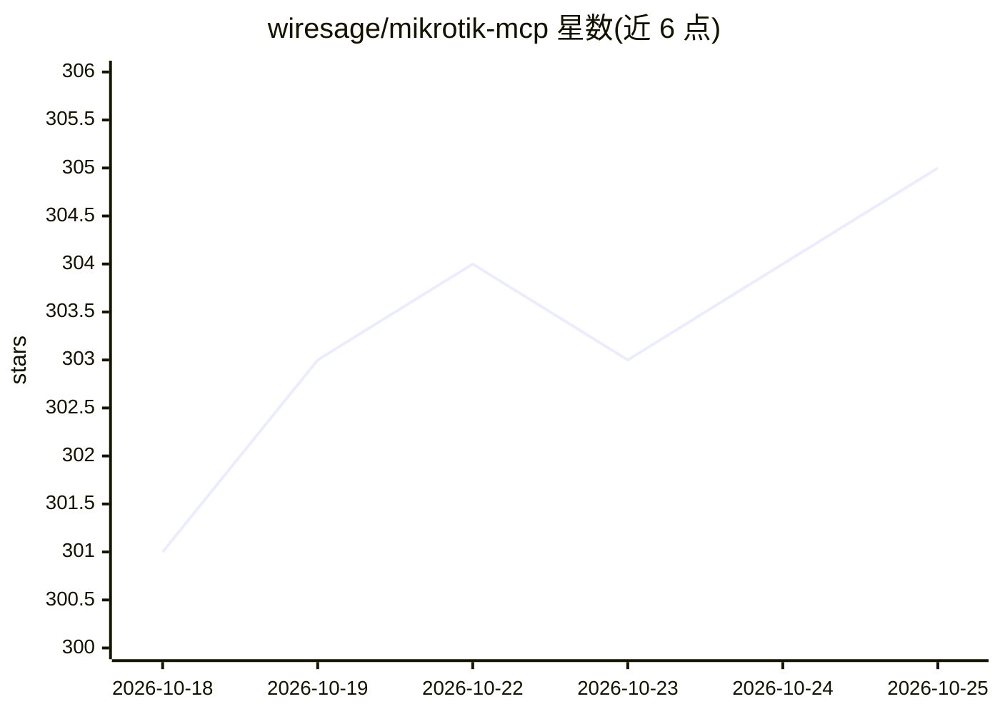

# wiresage/mikrotik-mcp

⭐ 306 · Python · MIT · 推送 2026-10-24 · [GitHub](https://github.com/wiresage/mikrotik-mcp) · [官网](https://mikrotik-mcp.com) · 组织维护

**让 AI 助手通过自然语言管理 MikroTik 路由器的 MCP 服务器**

在 AI 助手与 MikroTik RouterOS 设备之间提供 MCP 桥接层：AI 助手可经自然语言请求执行管理 VLAN、配置防火墙规则、处理 DNS 设置等操作。自 0.14.0 版起支持以 inventory 结构管理多台 MikroTik 设备，让 LLM 与设备群对话。提供 Claude Desktop 集成与 MCP Inspector 交互测试途径，完整文档发布于独立站点与仓库。以 MIT 许可开源，由多名贡献者协作维护。

## 筛选速览

| 维度 | 判定 | 备注 |
|---|---|---|
| AI 角色 | `ai-ecosystem` | LLM/agent 周边工具 |
| 许可风险 | `permissive` | MIT |
| 部署形态 | `None` |  |
| 模型依赖 | — | README 未给出锁定关系 |
| 硬件要求 | — | 无带数字的原话,不猜 |
| 安装摩擦 | `low` | 无编译、无系统依赖或容器化 |
| 成熟度 | — | 结构信号不足 |

## 能力要点

- MCP 桥接：AI 助手自然语言操作 MikroTik RouterOS
- 支持 VLAN、防火墙规则、DNS 设置等设备管理命令
- 0.14.0 起支持 inventory 结构管理多台设备
- 提供 Claude Desktop 集成与 MCP Inspector 测试

## 适用场景

- 通过 Claude Desktop 等助手用自然语言配置路由器
- 统一管理多台 MikroTik 设备并让 LLM 对接设备群
- 网络运维场景下用对话方式调整 VLAN 与防火墙规则

## 场景标签

 · 领域:网络管理/AI 工具集成

## 证据(README 行号)

> L14: MikroTik MCP provides a bridge between AI assistants and MikroTik RouterOS devices. It allows AI assistants to inte
> L28: > Since MikroTik MCP version `0.14.0`, the MikroTik MCP will allow you to manage multiple MikroTik devices within y

## 星数曲线

2026-10-18 301 → 2026-10-25 305（+4）

---
*卡片 v1 · prompt 1.4 · 生成 2026-10-21 · 置信度 mid · 依据 README sha `bebb1b384249` · [字段定义](../../DATASET.md)*
