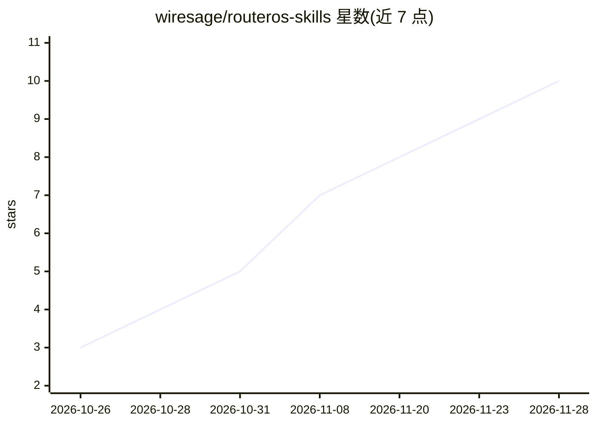

# wiresage/routeros-skills

⭐ 10 · Python · MIT · 推送 2026-11-05 · [GitHub](https://github.com/wiresage/routeros-skills) · [官网](https://mikrotik-mcp.com) · 组织维护

**教 AI 编码代理使用 MikroTik RouterOS 的技能库**

将 MikroTik RouterOS 官方文档抓取并转换为 Markdown，组织成 30 余个按领域划分的 Agent 技能文件夹（SKILL.md 指令 + references 参考文档），覆盖防火墙、路由、VPN、无线、脚本等方向。采用便携的 Agent Skills 格式，配合 Claude Code、Codex、GitHub Copilot 等代理使用；通过与 mikrotik-mcp 搭配可对真实设备读写，并计划与 routeros-lsp 组成 MikroTik 代理的知识层。MIT 许可，通过 skills.sh 或仓库内安装脚本分发。

## 筛选速览

| 维度 | 判定 | 备注 |
|---|---|---|
| AI 角色 | `ai-knowledge` | 知识聚合/清单类 |
| 许可风险 | `permissive` | MIT |
| 部署形态 | `library` | 以包/库形式分发 |
| 模型依赖 | — | README 未给出锁定关系 |
| 硬件要求 | — | 无带数字的原话,不猜 |
| 安装摩擦 | `low` | 无编译、无系统依赖或容器化 |
| 成熟度 | — | 结构信号不足 |

## 能力要点

- 30+ 个按 RouterOS 领域组织的 SKILL.md 技能，含 references 完整官方文档
- 内容来自 manual.mikrotik.com 的 llms.txt 索引，含快照日期与覆盖率核对文档
- 便携 Agent Skills 格式，兼容 Claude Code / Codex / GitHub Copilot
- 无实时设备时也可用：技能指导代理提出命令并说明验证方式

## 适用场景

- 让编码代理生成或审查 RouterOS 防火墙、路由、VPN 配置
- 为管理 MikroTik 设备的 MCP 工具链配套知识层
- 排查 RouterOS 故障时让代理按症状定位对应技能与文档

## 场景标签

`编码 Agent` `提示工程` · 领域:Agent 开发

## 证据(README 行号)

> L5: Each skill is a folder with a `SKILL.md` (short, task-oriented instructions) and a `references/` folder that holds t
> L9: The skills use only the portable Agent Skills format: a `name` and a `description` in the front matter, then Markdow
> L17: > With routeros-lsp they are meant to become the knowledge layer of a MikroTik

## 星数曲线

2026-10-26 3 → 2026-11-28 10（+7）

---
*卡片 v1 · prompt 1.4 · 生成 2026-11-20 · 置信度 high · 依据 README sha `8a5251846860` · [字段定义](../../DATASET.md)*
