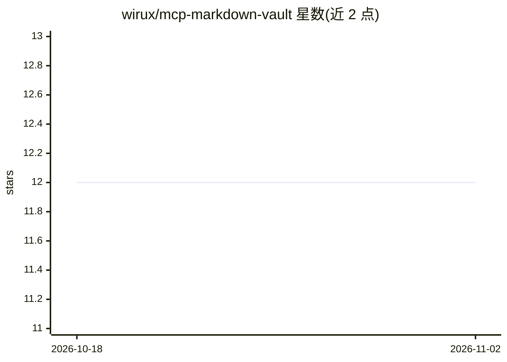

# wirux/mcp-markdown-vault

⭐ 12 · TypeScript · MIT · 推送 2026-10-03 · [GitHub](https://github.com/wirux/mcp-markdown-vault) · [官网](https://www.npmjs.com/package/@wirux/mcp-markdown-vault) · 个人维护

**面向 Markdown 笔记库的无头语义 MCP 服务器，供 AI 客户端读写检索**

为 Obsidian、Logseq、Dendron、Foam 及任意 .md 文件夹提供的 MCP 服务器：直接读写文件，无需运行笔记应用或插件。功能包括笔记 CRUD、基于 remark AST 的按标题/blockId 精准编辑（支持行范围与字符串替换回退、Levenshtein 模糊匹配、dryRun diff 预览、批量编辑）、按标题读取与多文件批量读取、混合向量+TF-IDF+邻近度语义搜索、反向链接索引、frontmatter 管理与模板建笔记。内置本地嵌入（all-MiniLM-L6-v2），可选用 Ollama 或 Qdrant。传输支持 stdio 与 SSE，提供 npm 包与 Docker 镜像，需 Node.js ≥ 22。

## 筛选速览

| 维度 | 判定 | 备注 |
|---|---|---|
| AI 角色 | `ai-ecosystem` | LLM/agent 周边工具 |
| 许可风险 | `permissive` | MIT |
| 部署形态 | `self-host` | docker 或自建部署 |
| 模型依赖 | local-ok | 支持本地模型 |
| 硬件要求 | — | 无带数字的原话,不猜 |
| 安装摩擦 | `low` | 无编译、无系统依赖或容器化 |
| 成熟度 | — | 结构信号不足 |

## 能力要点

- 无需笔记应用或插件，直接读写任意 .md 文件夹
- 混合向量+TF-IDF 语义搜索，零配置本地嵌入，Ollama 可选
- AST 级精准编辑：按标题/blockId 补丁、dryRun diff 预览、批量编辑（最多 50 操作）
- Stdio 与 SSE 双传输，支持 Docker 与多客户端

## 适用场景

- 让 Claude Desktop 等 MCP 客户端直接读写我的 Obsidian/Logseq 笔记库
- 对笔记做语义搜索并只返回相关片段以节省上下文窗口
- 通过 AI 客户端对笔记做精准的章节级编辑与 frontmatter 管理

## 场景标签

`知识库管理` `语义搜索` · 领域:知识与检索

## 证据(README 行号)

> L3: **Headless semantic MCP server for Obsidian, Logseq, Dendron, Foam, and any folder of markdown files.**
> L46: |🌐|**Dual transport**|Stdio (single client) or SSE over HTTP (multi-client, Docker-friendly)|

## 星数曲线

2026-10-18 12 → 2026-11-02 12（+0）

---
*卡片 v1 · prompt 1.4 · 生成 2026-10-31 · 置信度 high · 依据 README sha `d4f5f9034ca2` · [字段定义](../../DATASET.md)*
