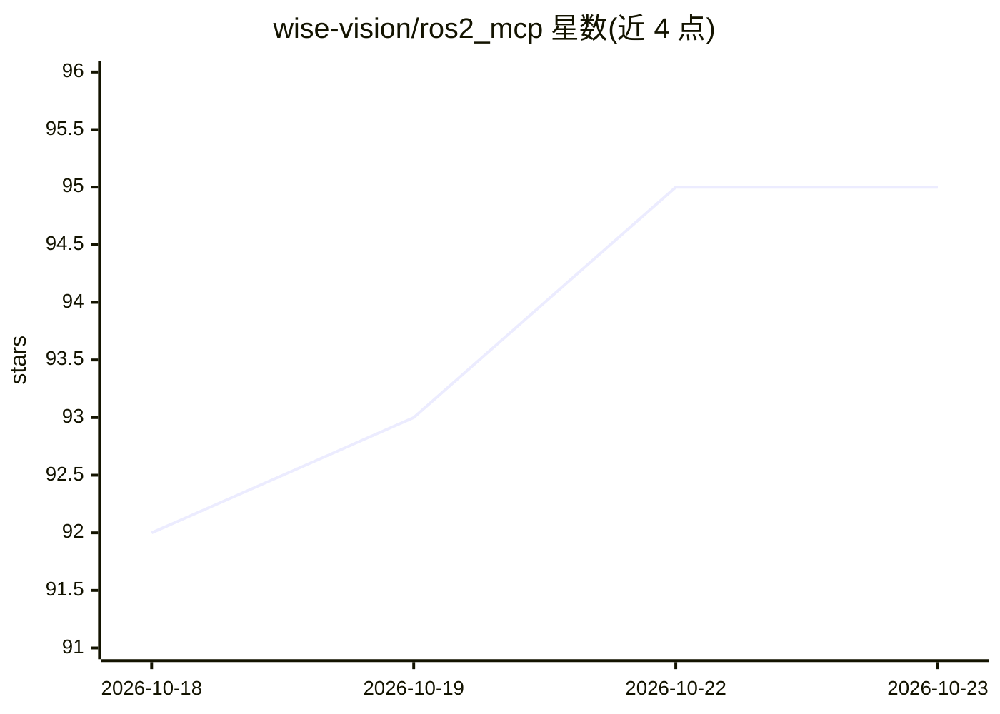

# wise-vision/ros2_mcp

⭐ 95 · Python · MPL-2.0 · 推送 2026-10-21 · [GitHub](https://github.com/wise-vision/ros2_mcp) · [官网](https://wisevision.tech) · 组织维护

**让 AI agent 直接操作 ROS 2 机器人的 MCP 服务器**

面向机器人开发与运维的 Model Context Protocol 服务器：通过 rclpy 直连 ROS 2 图（不经 rosbridge、不改机器人），供 Claude、Cursor、Codex 等 MCP 客户端的 agent 列出、订阅、发布话题，调用服务与完整 action 生命周期，并可将图像话题、占据栅格地图、点云以 PNG 返回。提供 24 个工具与只读模式（fail closed，变更类工具不注册），支持 stdio 与 Streamable HTTP 传输。支持 ROS 2 Humble/Jazzy，需 Python 3.10+，Docker 镜像内置 ROS 2；维护方 WiseVision 提供商业支持。

## 筛选速览

| 维度 | 判定 | 备注 |
|---|---|---|
| AI 角色 | `ai-ecosystem` | LLM/agent 周边工具 |
| 许可风险 | `permissive` | MPL-2.0 |
| 部署形态 | `self-host` | docker 或自建部署 |
| 模型依赖 | locked-api |  |
| 硬件要求 | — | 无带数字的原话,不猜 |
| 安装摩擦 | `low` | 无编译、无系统依赖或容器化 |
| 成熟度 | — | 结构信号不足 |

## 能力要点

- rclpy 直连 ROS 2 图，无需 rosbridge
- 24 个工具覆盖话题/服务/action 完整生命周期
- fail-closed 只读模式：变更类工具不注册并有测试约束
- 图像/占据栅格地图/点云转 PNG 返回，含交互式 viewer 应用

## 适用场景

- 让 Claude/Cursor 等 MCP 客户端以对话方式查看与操作真实机器人
- 在只读模式下让 agent 安全地观察机器人状态与话题数据
- 机器人部署中让 agent 读取地图、点云与历史消息（InfluxDB）

## 场景标签

 · 领域:机器人/AI 工具接入

## 证据(README 行号)

> L15: **ROS2 MCP** is an open-source (MPL-2.0) **Model Context Protocol** server that lets AI agents (Claude, Cursor, Cod
> L80: |How it reaches ROS|`rclpy`, directly on the ROS 2 graph (runs where ROS 2 is sourced, or in the Docker image)|`ros

## 星数曲线

2026-10-18 92 → 2026-10-23 95（+3）

---
*卡片 v1 · prompt 1.4 · 生成 2026-10-23 · 置信度 mid · 依据 README sha `cc1b13a992bb` · [字段定义](../../DATASET.md)*
