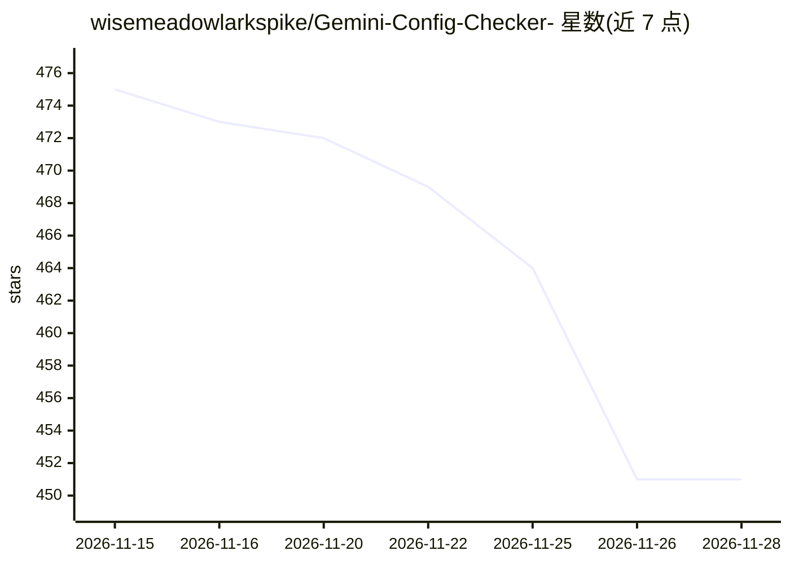

# wisemeadowlarkspike/Gemini-Config-Checker-

⭐ 451 · Go · Apache-2.0 · 推送 2026-11-15 · [GitHub](https://github.com/wisemeadowlarkspike/Gemini-Config-Checker-) · 个人维护

**检测代理配置能否进入 Google AI Studio 与 Gemini 的桌面工具**

面向需要通过代理访问 Google AI Studio / Gemini 的用户，批量扫描代理配置（vless/vmess/trojan/ss、订阅链接或 base64），通过已登录浏览器读取 Google 的区域判定，区分可用与被区域封锁的配置。提供 Simple（测自有配置）与 Advanced（基础配置串联免费配置换出口）两种模式，内置 Xray-core 引擎与可编辑的 anti-DPI 分片配置。支持 Windows/macOS/Linux 桌面版、Android APK 与 Web 服务器形态；区域检测需 Chrome/Edge/Brave，Android 仅连通性模式。

## 筛选速览

| 维度 | 判定 | 备注 |
|---|---|---|
| AI 角色 | `ai-ecosystem` | LLM/agent 周边工具 |
| 许可风险 | `permissive` | Apache-2.0 |
| 部署形态 | `desktop` | 安装包/桌面程序 |
| 模型依赖 | — | README 未给出锁定关系 |
| 硬件要求 | — | 无带数字的原话,不猜 |
| 安装摩擦 | `medium` | 含编译或系统依赖之一 |
| 成熟度 | `idea` | |

## 能力要点

- 以已登录浏览器读取 Google 对 AI Studio/Gemini 的区域判定（20–40 秒/配置）
- Simple/Advanced 双模式：直接测配置或将免费配置串联在基础配置后换出口
- 嵌入 Xray-core，anti-DPI 分片参数（Finalmask/ALPN/cipher）可编辑
- Windows/macOS/Linux/Android 桌面与应用构建，另有无认证的 Web 服务器模式

## 适用场景

- 批量验证手头代理配置哪些能真正打开 AI Studio 和 Gemini
- 基础 Cloudflare 配置可用但出口被 Google 拒绝时，链式寻找其他出口
- 封锁网络下用 anti-DPI 配置维持连接并测速排序

## 场景标签

 · 领域:网络工具/代理配置检测

## 证据(README 行号)

> L11: Find proxy configs that actually get you into **Google AI Studio and Gemini**, by testing each one the way a person
> L50: Google decides region availability **per signed-in account, after the page has loaded**. A plain HTTP request (even

## 星数曲线

2026-11-15 475 → 2026-11-28 451（-24）

---
*卡片 v1 · prompt 1.4 · 生成 2026-11-17 · 置信度 mid · 依据 README sha `846e83cebb20` · [字段定义](../../DATASET.md)*
