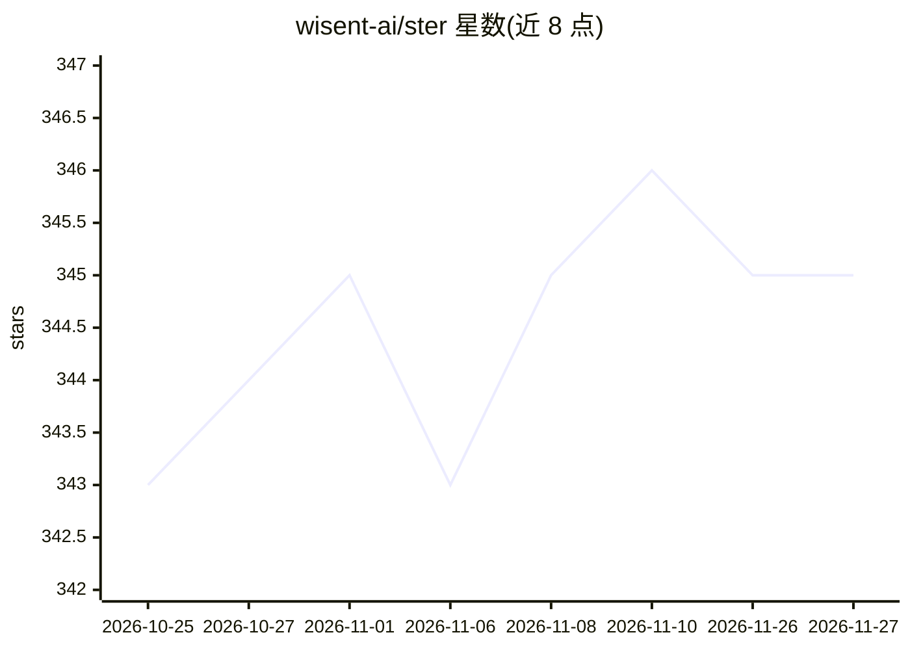

# wisent-ai/ster

⭐ 345 · Rust · MIT · 推送 2026-11-25 · [GitHub](https://github.com/wisent-ai/ster) · [官网](https://ster.wisent.com) · 组织维护

**对开源权重 LLM 做表征读取与激活转向的 Rust 工具包**

由 Wisent 公司开发的 Rust 工具包，面向开源权重语言模型：从选定 transformer 层读取隐藏状态，用对比样本学习方向，评估方向是否分离目标特质，并在生成时施加转向。同时训练 LoRA 适配器（监督、偏好、奖励建模、策略梯度四种目标），提供合并、评分与检查工具，还支持从单次前向传播回答类型化问题。以单一二进制与库 crate 形式提供，使用版本化 JSON 工件与 Candle 原生运行时。

## 筛选速览

| 维度 | 判定 | 备注 |
|---|---|---|
| AI 角色 | `ai-native` | 本体是模型或模型工具 |
| 许可风险 | `permissive` | MIT |
| 部署形态 | `library` | 以包/库形式分发 |
| 模型依赖 | — | README 未给出锁定关系 |
| 硬件要求 | — | 无带数字的原话,不猜 |
| 安装摩擦 | `medium` | 含编译或系统依赖之一 |
| 成熟度 | — | 结构信号不足 |

## 能力要点

- 支持大量模型架构的 Safetensors 检查点读取，覆盖范围以 vLLM 文本架构清单为基准跟踪
- 提供 CAA、PCA、逻辑探针三种方向学习方法和逐层 holdout 选择
- LoRA 监督微调、DPO/IPO、Bradley-Terry 奖励模型与 GRPO 训练
- CPU 运行，编译期可选 Metal 与 CUDA 后端

## 适用场景

- 研究语言模型内部表征并验证特质方向的可分性
- 对开源权重模型做激活转向以影响生成行为
- 对本地检查点做 LoRA 微调、偏好优化与奖励建模

## 场景标签

`微调` `强化学习` · 领域:训练与推理

## 证据(README 行号)

> L11: Ster is a native Rust toolkit for representation reading and activation steering
> L15: also trains the weights themselves: LoRA adapters under a supervised, a

## 星数曲线

2026-10-25 343 → 2026-11-27 345（+2）

---
*卡片 v1 · prompt 1.4 · 生成 2026-11-26 · 置信度 low · 依据 README sha `778dc5058cfc` · [字段定义](../../DATASET.md)*
