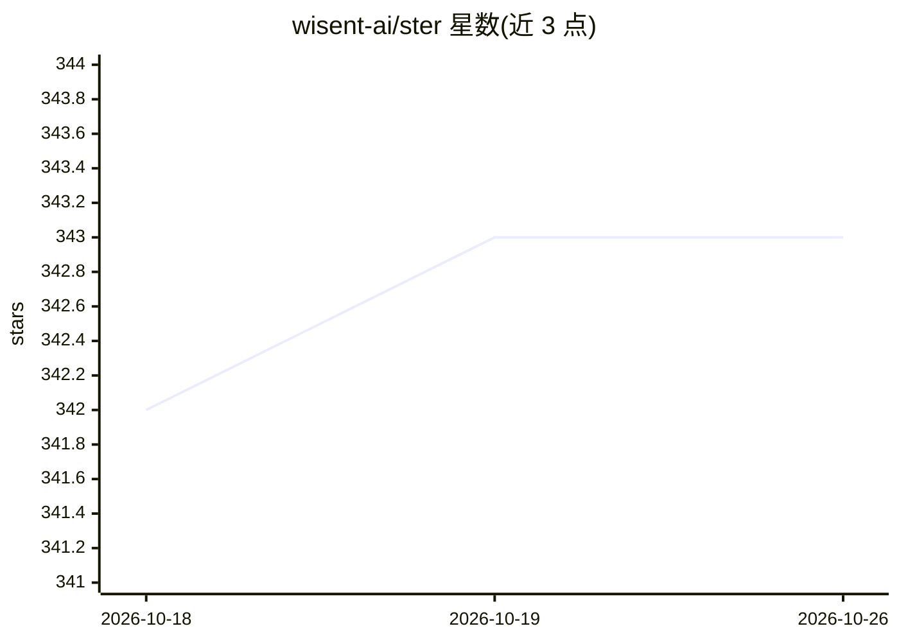

# wisent-ai/ster

⭐ 343 · Rust · MIT · 推送 2026-10-23 · [GitHub](https://github.com/wisent-ai/ster) · [官网](https://ster.wisent.com) · 组织维护

**开源权重 LLM 的表示读取与激活引导 Rust 工具包**

Wisent 公司开发的原生 Rust 二进制与库 crate：基于 Candle 运行时读取选定 transformer 层的隐藏状态，从对比样本学习方向（CAA/PCA/逻辑探针），在生成时施加残差流引导；支持 LoRA 监督微调、DPO/IPO、Bradley-Terry 奖励模型与 GRPO 训练，以及适配器合并与冻结应用。覆盖上百种 model_type 的未量化 Safetensors 检查点，量化检查点与部分架构的适配器目标被拒绝。支持 CPU 执行与编译期 Metal/CUDA 后端。给做模型可解释性、对齐与引导实验的开发者和研究者使用。

## 筛选速览

| 维度 | 判定 | 备注 |
|---|---|---|
| AI 角色 | `ai-ecosystem` | LLM/agent 周边工具 |
| 许可风险 | `permissive` | MIT |
| 部署形态 | `library` | 以包/库形式分发 |
| 模型依赖 | locked-api |  |
| 硬件要求 | — | 无带数字的原话,不猜 |
| 安装摩擦 | `medium` | 含编译或系统依赖之一 |
| 成熟度 | — | 结构信号不足 |

## 能力要点

- 从对比样本学习方向并评估分离度，生成时施加残差流引导
- LoRA 监督微调、DPO/IPO、Bradley-Terry 奖励模型与 GRPO 训练
- 支持上百种 model_type 的未量化 Safetensors 本地与 Hugging Face 检查点
- 单次前向传播回答类型化问题，为每个选项给出概率且不生成文本

## 适用场景

- 对开源权重模型做激活引导以控制生成行为
- 训练与合并 LoRA 适配器（SFT/DPO/奖励模型/GRPO）
- 读取并分析选定层的隐藏状态与表示方向
- 构建与评估对比样本对用于表示工程实验

## 场景标签

`微调` `强化学习` · 领域:训练与推理

## 证据(README 行号)

> L11: Ster is a native Rust toolkit for representation reading and activation steering
> L25: Ster 0.14 provides one binary and one library crate. Both use the same versioned

## 星数曲线

2026-10-18 342 → 2026-10-26 343（+1）

---
*卡片 v1 · prompt 1.4 · 生成 2026-10-21 · 置信度 mid · 依据 README sha `0a46c9a70b22` · [字段定义](../../DATASET.md)*
