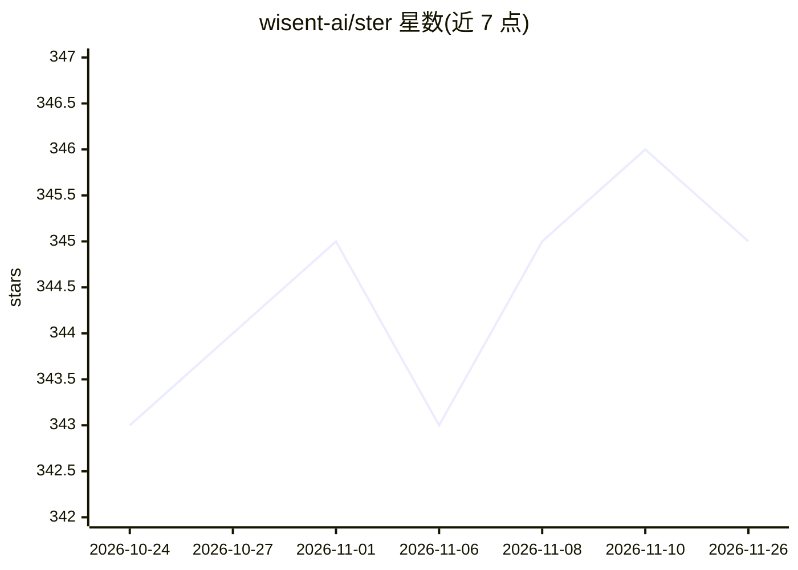

# wisent-ai/ster

⭐ 345 · Rust · MIT · 推送 2026-11-25 · [GitHub](https://github.com/wisent-ai/ster) · [官网](https://ster.wisent.com) · 组织维护

**对开源权重语言模型做表征读取与激活转向的 Rust 工具包**

Ster 是 Wisent 公司开发的 Rust 工具包，面向开放权重语言模型的表征工程：从指定 transformer 层读取隐藏状态，从对比样本学习方向并评估其区分性，在生成时施加残差流转向；同时训练 LoRA 适配器（SFT、偏好优化、奖励建模、策略梯度），并提供合并、打分、检查工具。以单一二进制与库 crate 提供，基于 Candle 运行时，支持 CPU 及 Metal/CUDA 编译后端，支持大量 Hugging Face 架构的未量化 Safetensors 检查点。

## 筛选速览

| 维度 | 判定 | 备注 |
|---|---|---|
| AI 角色 | `ai-ecosystem` | LLM/agent 周边工具 |
| 许可风险 | `permissive` | MIT |
| 部署形态 | `library` | 以包/库形式分发 |
| 模型依赖 | — | README 未给出锁定关系 |
| 硬件要求 | — | 无带数字的原话,不猜 |
| 安装摩擦 | `medium` | 含编译或系统依赖之一 |
| 成熟度 | — | 结构信号不足 |

## 能力要点

- 从任意选定层提取末 token 隐藏状态，训练 CAA/PCA/逻辑探针方向
- 生成期加性残差流转向（激活转向）
- LoRA SFT、DPO/IPO、Bradley-Terry 奖励模型、GRPO 训练与合并
- 支持大量 model_type 架构，覆盖对照 vLLM 文本架构清单

## 适用场景

- 对开源权重模型做表征读取与激活转向实验
- 训练 LoRA 适配器并合并为独立检查点
- 复现表示工程研究中的对比对构造与留出评估

## 场景标签

`微调` `强化学习` · 领域:训练与推理

## 证据(README 行号)

> L11: Ster is a native Rust toolkit for representation reading and activation steering
> L16: preference, a reward-modelling or a policy-gradient objective, and the tools to

## 星数曲线

2026-10-24 343 → 2026-11-26 345（+2）

---
*卡片 v1 · prompt 1.4 · 生成 2026-11-25 · 置信度 low · 依据 README sha `645680cbf795` · [字段定义](../../DATASET.md)*
