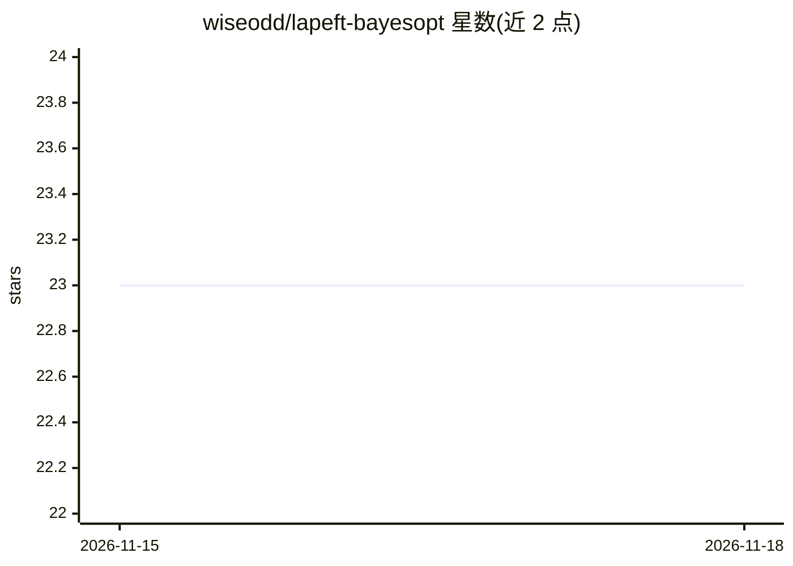

# wiseodd/lapeft-bayesopt

⭐ 23 · Python · MIT · 推送 2026-11-15 · [GitHub](https://github.com/wiseodd/lapeft-bayesopt) · 个人维护

**给科研者的库：用 LLM+PEFT+Laplace 近似做离散贝叶斯优化**

ICML 2024 论文的配套 Python 库，面向分子/材料发现等离散候选集上的贝叶斯优化。提供两条路径：将冻结 LLM 作为固定特征提取器（封装提示、取最后层嵌入聚合为特征向量），或在冻结 LLM 上附加 PEFT 方法（当前支持 LoRA，基于 HuggingFace peft）并对其权重做 Laplace 近似，得到带后验均值与方差的代理模型，配合 Thompson 采样等采集函数执行 BO 循环。要求 Python 3.11+，PyPI 安装，附带示例工程与缓存特征数据。需在每轮迭代重训代理模型。

## 筛选速览

| 维度 | 判定 | 备注 |
|---|---|---|
| AI 角色 | `ai-ecosystem` | LLM/agent 周边工具 |
| 许可风险 | `permissive` | MIT |
| 部署形态 | `library` | 以包/库形式分发 |
| 模型依赖 | — | README 未给出锁定关系 |
| 硬件要求 | — | 无带数字的原话,不猜 |
| 安装摩擦 | `medium` | 含编译或系统依赖之一 |
| 成熟度 | — | 结构信号不足 |

## 能力要点

- LLM 作为固定特征提取器：提示构建、嵌入聚合为候选点特征
- LoRA 微调 + Laplace 近似代理模型（LAPEFT），输出后验均值/方差
- 基于 HuggingFace peft 库，可扩展其他 PEFT 方法
- 提供自包含示例（固定特征与微调两条路径）与缓存特征

## 适用场景

- 在分子候选池上做离散贝叶斯优化寻找最优分子
- 材料发现实验中用 LLM 嵌入做代理模型
- 复现论文中 LLM-BO 方法的对比实验

## 场景标签

`科研工具` · 领域:学习与行业

## 证据(README 行号)

> L3: This is the accompanying library of the paper _A Sober Look at LLMs for Material Discovery: Are They Actually Good f
> L81: This can be done by attaching a PEFT method (LoRA, PrefixTuning, Adapter, etc) to the frozen LLM.
> L85: Currently LoRA is supported and it is very easy to support other PEFT methods, using Huggingface's `peft` library.

## 星数曲线

2026-11-15 23 → 2026-11-18 23（+0）

---
*卡片 v1 · prompt 1.4 · 生成 2026-11-18 · 置信度 high · 依据 README sha `1dd2c262f235` · [字段定义](../../DATASET.md)*
