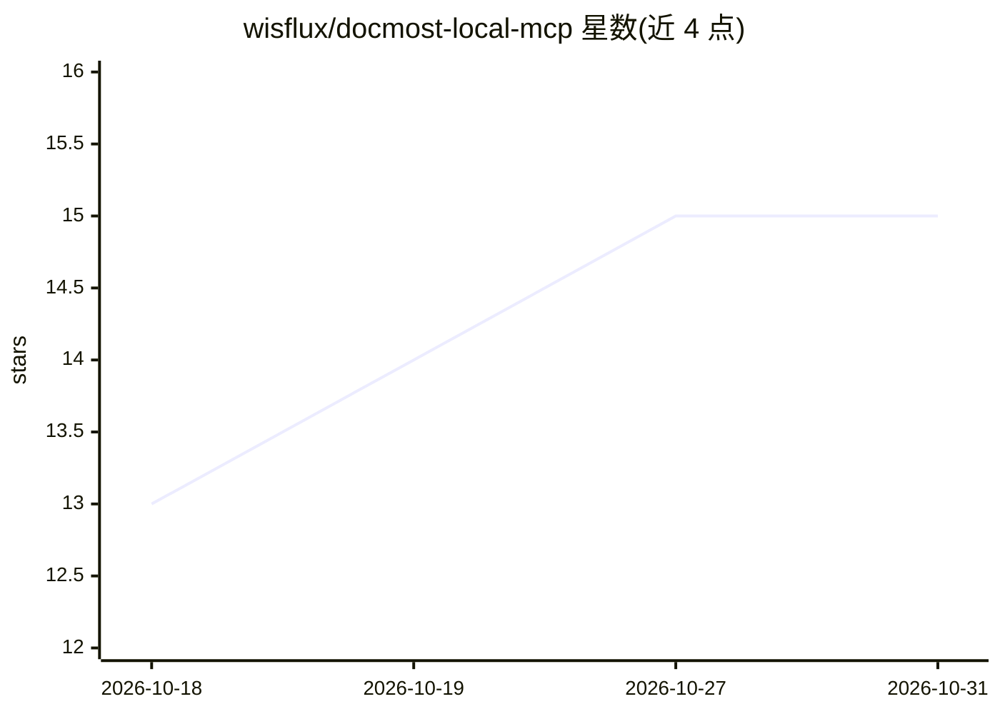

# wisflux/docmost-local-mcp

⭐ 15 · Rust · MIT · 推送 2026-07-12 · [GitHub](https://github.com/wisflux/docmost-local-mcp) · [官网](https://www.npmjs.com/package/@wisflux/docmost-local-mcp) · 个人维护

**自托管 Docmost 的 MCP server：让 AI 客户端读写 wiki**

面向自托管 Docmost（无企业许可）的 MCP 服务器，以 npx 启动 Node 包装器、安装时从 GitHub Releases 下载 Rust 二进制，处理 stdio MCP 流量与 Docmost API 访问。提供 19 个工具覆盖空间、页面、评论与成员的读写操作，页面内容以 Markdown 交互。认证走本地登录页（原生 webview 或浏览器回退），会话本地存储、凭据存 OS 钥匙串，支持 JWT 过期自动重登。限制：旧版 Docmost（<v0.70）REST 无法更新页面正文，不支持上传附件。

## 筛选速览

| 维度 | 判定 | 备注 |
|---|---|---|
| AI 角色 | `ai-ecosystem` | LLM/agent 周边工具 |
| 许可风险 | `permissive` | MIT |
| 部署形态 | `library` | 以包/库形式分发 |
| 模型依赖 | — | README 未给出锁定关系 |
| 硬件要求 | — | 无带数字的原话,不猜 |
| 安装摩擦 | `low` | 无编译、无系统依赖或容器化 |
| 成熟度 | — | 结构信号不足 |

## 能力要点

- 19 个工具覆盖空间/页面/评论/成员的读写与移动复制
- Rust 二进制核心 + npx 启动器，本地认证窗口与钥匙串凭据存储
- 兼容 Claude Desktop、Cursor、Claude Code、VS Code 等 MCP 客户端
- 针对 Docmost v0.22+ 做版本检测与行为适配

## 适用场景

- 在 Cursor/Claude Desktop 里搜索和总结自托管 Docmost 的文档
- 让 AI 客户端把会议记录或笔记直接写成 Docmost 页面
- 通过对话批量整理、移动或复制 wiki 页面

## 场景标签

`知识库管理` · 领域:知识与检索

## 证据(README 行号)

> L7: MCP server for Docmost that is built for self-hosted instances, especially deployments that do not have an enterpris
> L120: - **Claude Desktop** — `claude_desktop_config.json` (Settings → Developer → Edit Config)

## 星数曲线

2026-10-18 13 → 2026-10-31 15（+2）

---
*卡片 v1 · prompt 1.4 · 生成 2026-10-30 · 置信度 high · 依据 README sha `7ad605b3492a` · [字段定义](../../DATASET.md)*
