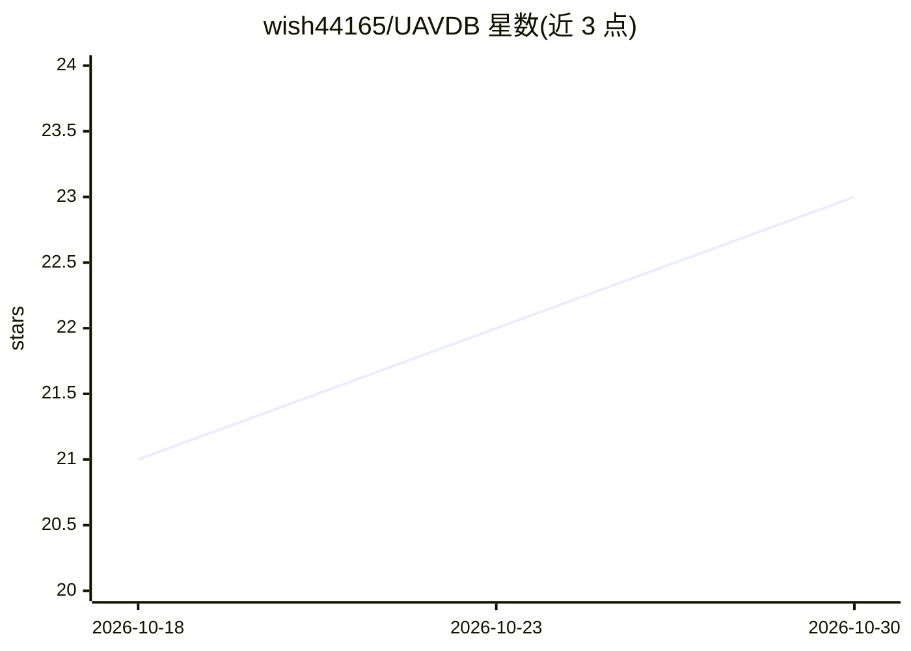

# wish44165/UAVDB

⭐ 23 · Python · MIT · 推送 2026-10-01 · [GitHub](https://github.com/wish44165/UAVDB) · [官网](https://icpr2026.org/acceptedPapersTrack.html) · 个人维护

**UAV 检测与分割基准数据集（含 PIC 标注生成方法）**

面向无人机（UAV）目标检测与实例分割研究的基准数据集：基于多视角无人机跟踪数据集，先用提出的 Patch Intensity Convergence (PIC) 方法将轨迹点转换为精确边界框，再用 SAM2 生成跨视频帧的高质量实例掩码。数据集含 18,061 张图像（训练 10,763、验证 2,720、测试 4,578），并以 Ultralytics YOLO 系列（v8 至 yolo26）报告检测与分割基线结果。论文投稿 ICPR 2026，提供 Conda 环境配置说明。

## 筛选速览

| 维度 | 判定 | 备注 |
|---|---|---|
| AI 角色 | `ai-knowledge` | 知识聚合/清单类 |
| 许可风险 | `permissive` | MIT |
| 部署形态 | `None` |  |
| 模型依赖 | — | README 未给出锁定关系 |
| 硬件要求 | — | 无带数字的原话,不猜 |
| 安装摩擦 | `low` | 无编译、无系统依赖或容器化 |
| 成熟度 | — | 结构信号不足 |

## 能力要点

- PIC 方法将轨迹点转为精确边界框
- SAM2 生成跨帧高质量实例掩码
- 18,061 张图像，含训练/验证/测试划分
- 14 个 YOLO 检测模型与 2 个分割模型的基准结果表

## 适用场景

- 训练和评测 UAV 目标检测或实例分割模型
- 复现论文中的 PIC 标注生成流程
- 对比不同 YOLO 版本在无人机数据上的表现

## 场景标签

`目标检测` `模型评测` · 领域:评测与运维

## 证据(README 行号)

> L15: This repository introduces UAVDB, a benchmark for UAV detection and segmentation. Built on the multi-view drone tra
> L74: Overview of UAVDB constructed using the PIC approach, showing the distribution of 10,763 training, 2,720 validation

## 星数曲线

2026-10-18 21 → 2026-10-30 23（+2）

---
*卡片 v1 · prompt 1.4 · 生成 2026-10-27 · 置信度 high · 依据 README sha `3851a5442897` · [字段定义](../../DATASET.md)*
