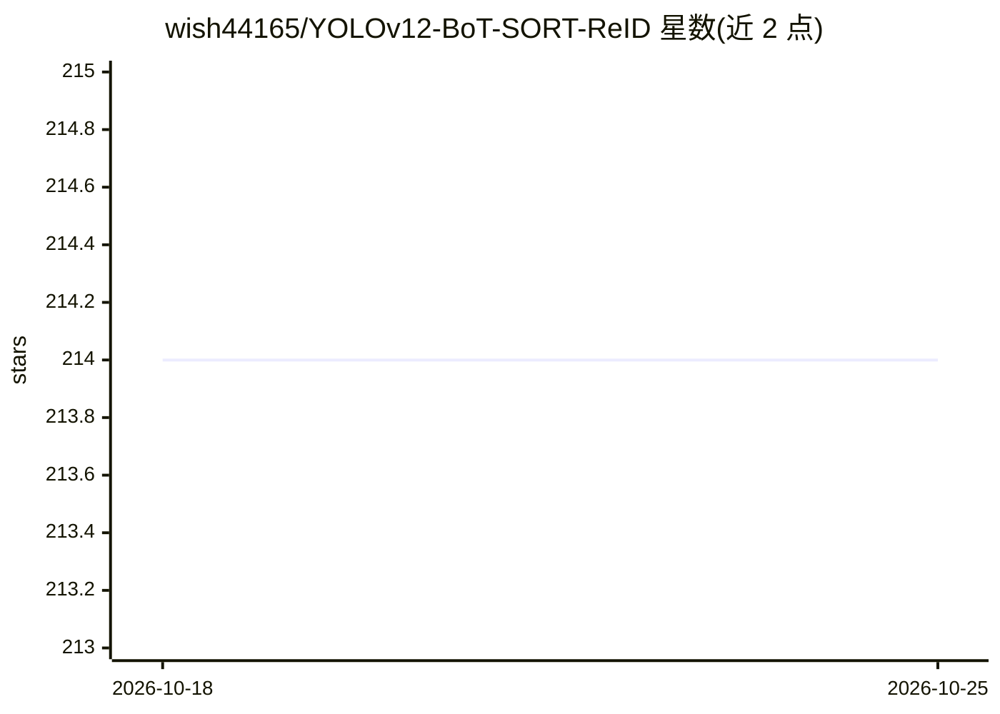

# wish44165/YOLOv12-BoT-SORT-ReID

⭐ 214 · Python · AGPL-3.0 · 推送 2026-10-01 · [GitHub](https://github.com/wish44165/YOLOv12-BoT-SORT-ReID) · [官网](https://anti-uav.github.io/) · 个人维护 · 中文 README

**热红外视频中多无人机检测与跟踪的基线框架（YOLOv12+BoT-SORT-ReID）**

CVPR 2025 第 4 届 Anti-UAV Workshop & Challenge Track 3 季军方案：以 YOLOv12 做检测、BoT-SORT 加 ReID 做多目标跟踪，面向热红外视频中的多无人机（UAV）跟踪，并提供跟踪竞赛与 200 段视频数据集。支持对图像文件夹与视频文件推理、接入自定义训练模型扩展到非 UAV 场景；提供训练与推理脚本、conda 安装流程和 Colab/Kaggle notebook。macOS 上仅 CPU 推理，不支持 ReID 与初始位置。

## 筛选速览

| 维度 | 判定 | 备注 |
|---|---|---|
| AI 角色 | `ai-native` | 本体是模型或模型工具 |
| 许可风险 | `viral` | AGPL-3.0 |
| 部署形态 | `library` | 以包/库形式分发 |
| 模型依赖 | — | README 未给出锁定关系 |
| 硬件要求 | — | 无带数字的原话,不猜 |
| 安装摩擦 | `medium` | 含编译或系统依赖之一 |
| 成熟度 | — | 结构信号不足 |

## 能力要点

- YOLOv12 检测 + BoT-SORT-ReID 多目标跟踪流水线
- 支持自定义训练模型推理，可扩展至非 UAV 场景与多类别检测
- 提供训练脚本、ReID 训练配置与竞赛结果复现命令
- 公开 200 段视频（151,384 帧）数据集与在线竞赛

## 适用场景

- 热红外视频中的多无人机检测与跟踪
- Anti-UAV 竞赛参赛或结果复现
- 用自定义检测模型替换 YOLOv12 做通用 MOT 推理

## 场景标签

`目标检测` · 领域:感知与多模态

## 证据(README 行号)

> L3: > Strong Baseline: Multi-UAV Tracking via YOLOv12 with BoT-SORT-ReID
> L36: This repository provides a strong baseline for multi-UAV tracking in thermal infrared videos by leveraging YOLOv12 

## 星数曲线

2026-10-18 214 → 2026-10-25 214（+0）

---
*卡片 v1 · prompt 1.4 · 生成 2026-10-22 · 置信度 mid · 依据 README sha `312617efabb9` · [字段定义](../../DATASET.md)*
