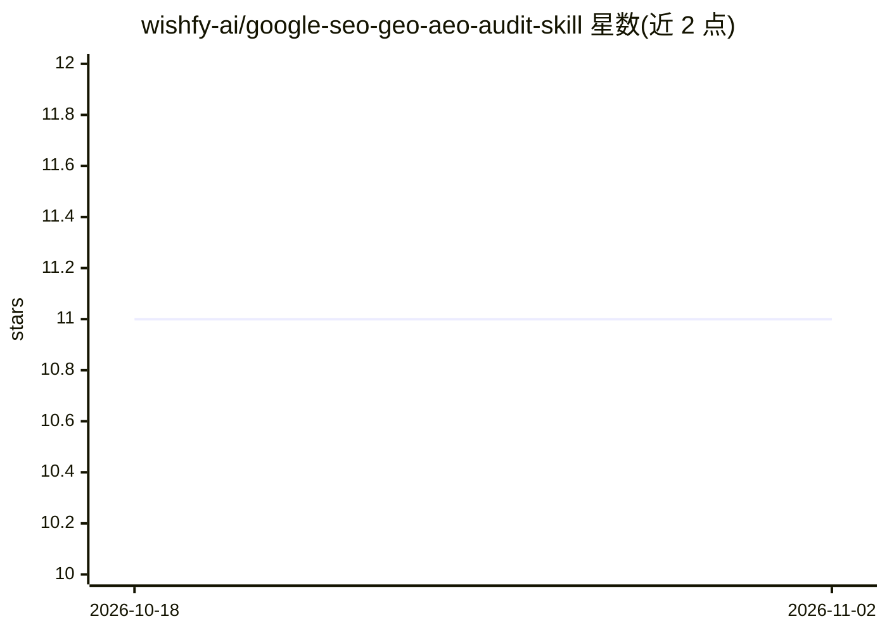

# wishfy-ai/google-seo-geo-aeo-audit-skill

⭐ 11 · Python · MIT · 推送 2026-05-17 · [GitHub](https://github.com/wishfy-ai/google-seo-geo-aeo-audit-skill) · [官网](https://wishfy.ai) · 组织维护

**面向 Claude Code 的网站 SEO/GEO/AEO 合规审计技能**

一个 Claude Code skill（也可经命令行脚本直接运行）：爬取目标网站（sitemap 优先、robots.txt 约束、默认上限 50 页），采集渲染 HTML、结构化数据、Lighthouse 与 PageSpeed Insights/CrUX 字段数据，评估约 80 条规则，每条规则带 MUST/SHOULD/NICE 严重级别和 Google 文档引用，输出 audit.json 与 audit.md 及 Not Ready/Competitive/Leading 三档结论。特色覆盖 AI 检索 bot（OAI-SearchBot、PerplexityBot 等）访问检查与过时 SEO 指南的弃用判定。需要免费 PageSpeed API key 获取字段数据（缺失时降级本地 Lighthouse）。

## 筛选速览

| 维度 | 判定 | 备注 |
|---|---|---|
| AI 角色 | `ai-ecosystem` | LLM/agent 周边工具 |
| 许可风险 | `permissive` | MIT |
| 部署形态 | `library` | 以包/库形式分发 |
| 模型依赖 | locked-api |  |
| 硬件要求 | — | 无带数字的原话,不猜 |
| 安装摩擦 | `low` | 无编译、无系统依赖或容器化 |
| 成熟度 | — | 结构信号不足 |

## 能力要点

- 约 80 条规则，每条含严重级别与 Google 文档引用
- AI 检索 bot（OAI-SearchBot/PerplexityBot 等）allow-list 检查
- 输出 audit.json 与 audit.md，附三档结论（Not Ready/Competitive/Leading）
- rules.yaml 反映 Google 文档现状，对已弃用做法（FAQPage/HowTo 等）做弃用标记

## 适用场景

- 上线前按 Google 官方文档逐条核查网站的 SEO 合规性
- 检查网站在 ChatGPT/Perplexity 等 AI 搜索中的 bot 可访问性
- 审计 Core Web Vitals（LCP/INP/CLS）并拿到带出处的修复清单

## 场景标签

`网页抓取` · 领域:效率与自动化

## 证据(README 行号)

> L5: Claude Code skill
> L29: Then in Claude Code:
> L26: npx skills add https://github.com/wishfyai/google-seo-geo-aeo-audit-skill --skill google-audit

## 星数曲线

2026-10-18 11 → 2026-11-02 11（+0）

---
*卡片 v1 · prompt 1.4 · 生成 2026-11-01 · 置信度 mid · 依据 README sha `71e14f6a5967` · [字段定义](../../DATASET.md)*
