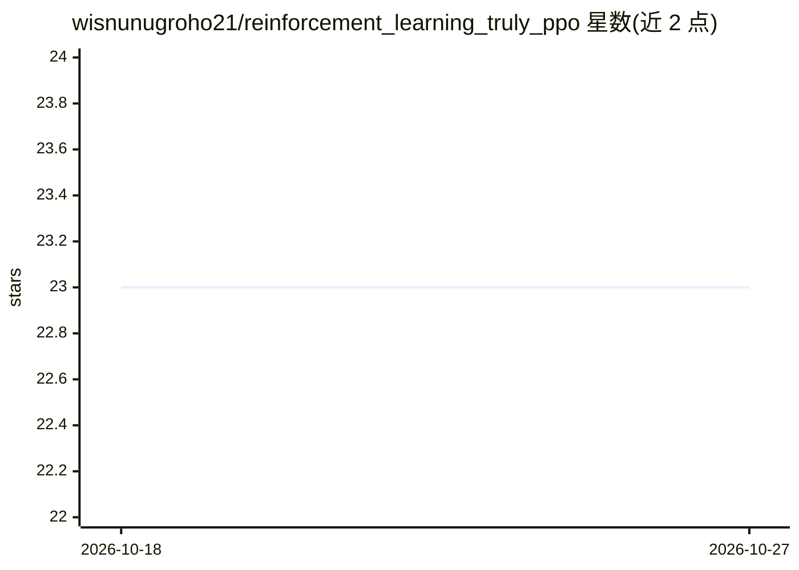

# wisnunugroho21/reinforcement_learning_truly_ppo

⭐ 23 · Python · GPL-3.0 · 推送 2025-11-09 · [GitHub](https://github.com/wisnunugroho21/reinforcement_learning_truly_ppo) · 个人维护

**Truly PPO 深度强化学习实现（PyTorch/TensorFlow 2）**

以 PyTorch 与 TensorFlow 2 双框架实现的 Truly PPO（Truly Proximal Policy Optimization）演示代码：在 PPO-Clip 基础上采用支持回滚的新裁剪函数与基于信任域的触发条件，以约束新旧策略差异。使用 Gym 作为环境，已在 LunarLander、Bipedal、Pendulum、Pong 上给出结果占位。作者计划扩展到 Atari、MuJoCo 等更复杂环境。通过 git clone 获取后分别运行 PyTorch 或 TensorFlow 2 脚本，作者建议 GPU 与 8GB 内存（非必需）。

## 筛选速览

| 维度 | 判定 | 备注 |
|---|---|---|
| AI 角色 | `ai-native` | 本体是模型或模型工具 |
| 许可风险 | `viral` | GPL-3.0 |
| 部署形态 | `None` |  |
| 模型依赖 | — | README 未给出锁定关系 |
| 硬件要求 | — | 无带数字的原话,不猜 |
| 安装摩擦 | `low` | 无编译、无系统依赖或容器化 |
| 成熟度 | — | 结构信号不足 |

## 能力要点

- 同时提供 PyTorch 与 TensorFlow 2 两版实现
- 实现 Truly PPO：新裁剪函数支持回滚，触发条件改为信任域
- 基于 Gym 环境训练，结果页覆盖 LunarLander/Bipedal/Pendulum/Pong

## 适用场景

- 学习 PPO 与 Truly PPO 算法的双框架参考实现
- 在 Gym 经典控制环境中复现训练
- 对比 PPO 与 Truly PPO 的实现差异

## 场景标签

`强化学习` · 领域:训练与推理

## 证据(README 行号)

> L3: Simple code to demonstrate Deep Reinforcement Learning by using Truly Proximal Policy Optimization in Tensorflow 2 a
> L15: This project is using Pytorch and Tensorflow 2 for Deep Learning Framework and using Gym for Reinforcement Learning

## 星数曲线

2026-10-18 23 → 2026-10-27 23（+0）

---
*卡片 v1 · prompt 1.4 · 生成 2026-10-27 · 置信度 high · 依据 README sha `1dafa6fe5333` · [字段定义](../../DATASET.md)*
