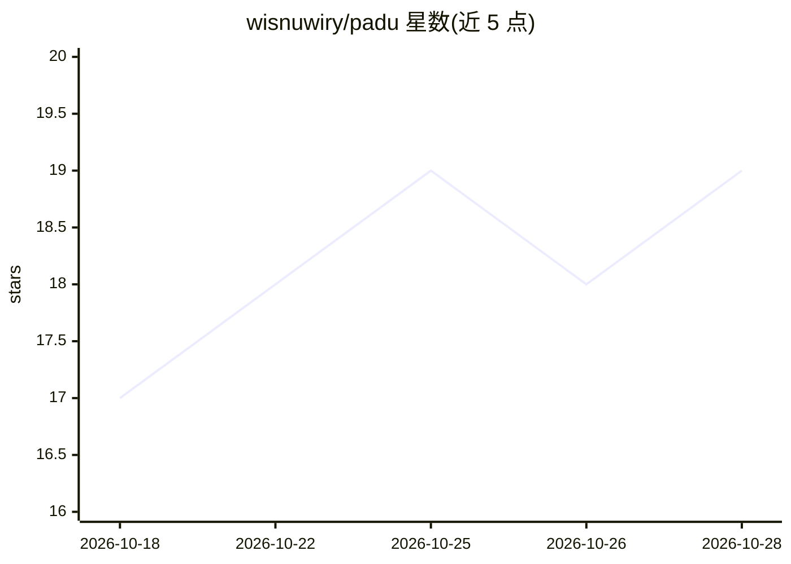

# wisnuwiry/padu

⭐ 19 · Rust · GPL-3.0 · 推送 2026-10-28 · [GitHub](https://github.com/wisnuwiry/padu) · [官网](https://padu.dev) · 个人维护

**本地 AI 编程 Agent 统一编排的原生桌面应用**

用 Rust 与 GPUI 构建的原生桌面应用（无 Electron），用于统一管理多个本地 CLI 编程 Agent：Amp、Claude Code、Codex CLI、Cursor CLI、Grok Build、Kimi Code、OpenCode 等。自动检测已安装的 Agent CLI，采用各提供方原生结构化协议与会话续接。功能包括统一工作区、共享模型/推理力度切换、工作中队列追加消息、Git 回退检查点；本地优先，数据留在本机。架构为桌面 RPC 客户端加独立 padu-daemon 进程。README 声明处于早期预览阶段。

## 筛选速览

| 维度 | 判定 | 备注 |
|---|---|---|
| AI 角色 | `ai-ecosystem` | LLM/agent 周边工具 |
| 许可风险 | `viral` | GPL-3.0 |
| 部署形态 | `desktop` | 安装包/桌面程序 |
| 模型依赖 | — | README 未给出锁定关系 |
| 硬件要求 | — | 无带数字的原话,不猜 |
| 安装摩擦 | `low` | 无编译、无系统依赖或容器化 |
| 成熟度 | `idea` | |

## 能力要点

- 自动检测并接入多种 CLI 编程 Agent（Claude Code、Codex CLI、Cursor CLI 等）
- 工作中可发送后续消息的队列与引导机制
- Git 回退的任务历史与对话感知检查点
- 本地优先：数据留在本机，无需账号

## 适用场景

- 在同一桌面应用中管理多个 AI 编程 Agent 的项目与会话
- 跨 Agent 统一切换模型与访问模式
- 查看任务历史并回退到之前的检查点

## 场景标签

`编码 Agent` · 领域:编码与开发

## 证据(README 行号)

> L24: Padu is a fast, native desktop app for working with local coding agents. Built
> L67: Padu works with:
> L81: Padu detects available CLIs automatically and uses each provider's native

## 星数曲线

2026-10-18 17 → 2026-10-28 19（+2）

---
*卡片 v1 · prompt 1.4 · 生成 2026-10-28 · 置信度 high · 依据 README sha `1b5b48f424f8` · [字段定义](../../DATASET.md)*
