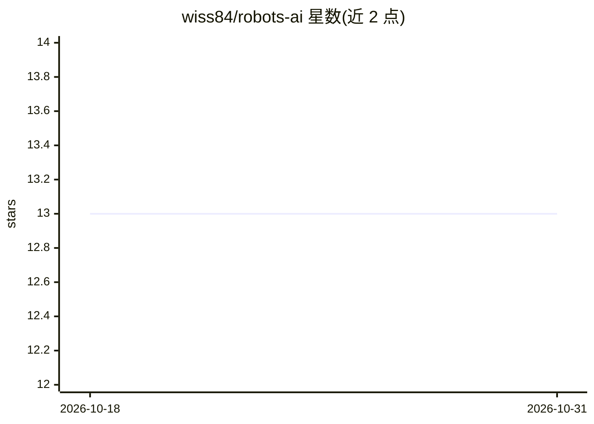

# wiss84/robots-ai

⭐ 13 · Python · MIT · 推送 2026-04-22 · [GitHub](https://github.com/wiss84/robots-ai) · 个人维护

**多智能体 AI 助手平台：编码/金融/新闻/旅行等专属 agent 对话服务**

React 前端 + Python FastAPI 后端的多智能体助手平台，包含编码、金融、新闻、房产、旅行、图像生成、购物、国际象棋共 8 个专属 agent。模型主要依赖 Google Gemini/Gemma 免费额度，README 声明因 2025 年 12 月起免费层配额收紧（每日约 20 次），项目无法按预期运行，需绑定付费账户或改造限流脚本接入 GPT/Claude/开源模型。语音输入输出尚未集成，房产搜索仅覆盖美国。安装走 git clone + conda + pip/npm，可选 docker-compose，需自建 Supabase 数据库与多个第三方 API key。

## 筛选速览

| 维度 | 判定 | 备注 |
|---|---|---|
| AI 角色 | `ai-native` | 本体是模型或模型工具 |
| 许可风险 | `permissive` | MIT |
| 部署形态 | `self-host` | docker 或自建部署 |
| 模型依赖 | — | README 未给出锁定关系 |
| 硬件要求 | — | 无带数字的原话,不猜 |
| 安装摩擦 | `low` | 无编译、无系统依赖或容器化 |
| 成熟度 | — | 结构信号不足 |

## 能力要点

- 8 个专属 agent：编码/金融/新闻/房产/旅行/图像生成/购物/国际象棋
- 对话记忆、文件上传与 OCR/PDF 解析、多模态文本图像处理
- 房产/旅行 agent 支持内联地图标记与图片展示
- 可选 Docker Compose 部署，另提供 Windows .bat 一键启动脚本

## 适用场景

- 在统一界面中与多个领域专属 agent 对话完成各类任务
- 让编码 agent 进行代码生成、审查与代码库读写
- 查询美国在售房源、规划旅行行程并生成图像

## 场景标签

`多智能体` `AI 助手` `聊天机器人` `图像生成` · 领域:Agent 开发

## 证据(README 行号)

> L5: A sophisticated multi-agent AI system built with React frontend and Python backend, featuring specialized AI agents 
> L55: As of December 2025. The project will not work as expected since google nerfed the number of requests for gemini mo

## 星数曲线

2026-10-18 13 → 2026-10-31 13（+0）

---
*卡片 v1 · prompt 1.4 · 生成 2026-10-31 · 置信度 high · 依据 README sha `6968c526fef6` · [字段定义](../../DATASET.md)*
