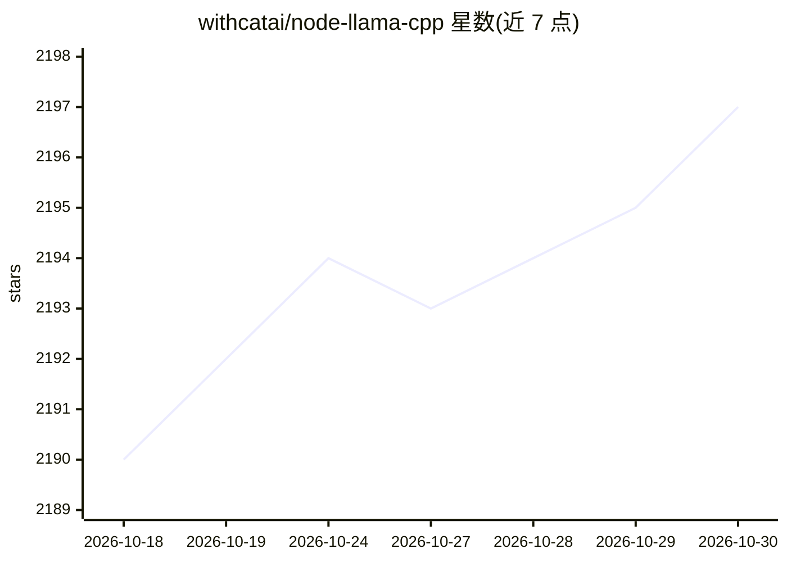

# withcatai/node-llama-cpp

⭐ 2,197 · TypeScript · MIT · 推送 2026-10-20 · [GitHub](https://github.com/withcatai/node-llama-cpp) · [官网](https://node-llama-cpp.withcat.ai) · 组织维护

**Node.js 的 llama.cpp 绑定：在本地运行 LLM 并约束输出格式**

为 llama.cpp 提供 Node.js/TypeScript 绑定，使项目内本地运行 LLM：支持 Metal/CUDA/Vulkan、预编译二进制（缺失时回退用 cmake 从源码构建）、文本补全与对话、JSON Schema 级输出强制、函数调用、embedding 与 reranking、结构化决策，并提供无需写代码的 CLI 聊天命令。面向希望在 Node.js 项目中接入本地模型而无需 Python/node-gyp 的开发者。

## 筛选速览

| 维度 | 判定 | 备注 |
|---|---|---|
| AI 角色 | `ai-ecosystem` | LLM/agent 周边工具 |
| 许可风险 | `permissive` | MIT |
| 部署形态 | `library` | 以包/库形式分发 |
| 模型依赖 | — | README 未给出锁定关系 |
| 硬件要求 | — | 无带数字的原话,不猜 |
| 安装摩擦 | `medium` | 含编译或系统依赖之一 |
| 成熟度 | — | 结构信号不足 |

## 能力要点

- 生成层面强制 JSON Schema / 可解析格式输出
- 预编译二进制，回退 cmake 源码构建（无 node-gyp/Python）
- Metal/CUDA/Vulkan 支持，自动适配硬件
- 函数调用、embedding、reranking 与结构化决策

## 适用场景

- 在 Node.js 项目中本地运行 GGUF 模型
- 强制模型输出符合特定 JSON Schema 的结构化数据
- 终端里用一条命令直接与本地模型对话

## 场景标签

`推理引擎` · 领域:训练与推理

## 证据(README 行号)

> L3:  Run AI models locally on your machine
> L16: * Pre-built binaries are provided, with a fallback to building from source _**without**_ `node-gyp` or Python

## 星数曲线

2026-10-18 2,190 → 2026-10-30 2,197（+7）

---
*卡片 v1 · prompt 1.4 · 生成 2026-10-21 · 置信度 high · 依据 README sha `d5c7c2de5db4` · [字段定义](../../DATASET.md)*
