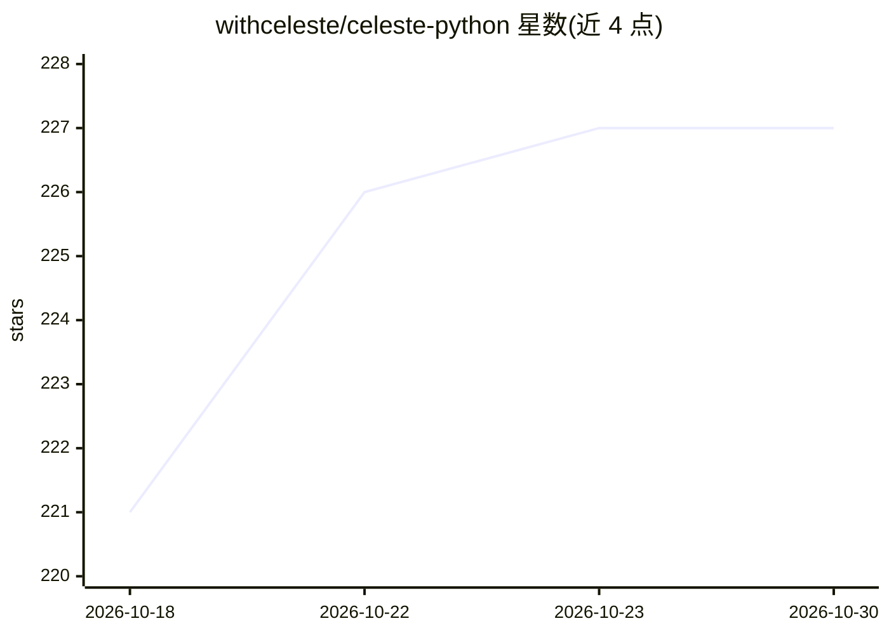

# withceleste/celeste-python

⭐ 227 · Python · MIT · 推送 2026-10-29 · [GitHub](https://github.com/withceleste/celeste-python) · [官网](https://withceleste.ai/) · 组织维护

**多模态 AI 的类型安全 Python 基础原语库，统一接口接多家提供商**

面向开发者的 Python SDK，用单一接口封装 OpenAI、Anthropic、Gemini、Mistral 等 15+ 提供商的多模态操作（文本/图像/音频/视频的生成、分析、转录、嵌入等）。不依赖各厂商 SDK，直接通过 HTTP 调用，参数经 Pydantic 校验并在调用前本地报错。切换提供商只需改配置字符串。定位为原语层而非框架，不含 agents/chains 抽象；部分能力（音频/视频生成、部分 upscale/embed）标注为 Planned。pip/uv 安装，MIT 许可。

## 筛选速览

| 维度 | 判定 | 备注 |
|---|---|---|
| AI 角色 | `ai-ecosystem` | LLM/agent 周边工具 |
| 许可风险 | `permissive` | MIT |
| 部署形态 | `library` | 以包/库形式分发 |
| 模型依赖 | local-ok | 支持本地模型 |
| 硬件要求 | — | 无带数字的原话,不猜 |
| 安装摩擦 | `low` | 无编译、无系统依赖或容器化 |
| 成熟度 | — | 结构信号不足 |

## 能力要点

- 单一接口覆盖 15+ 提供商的文本/图像/音频/视频多模态操作
- 无厂商 SDK 依赖，纯 HTTP 调用
- Pydantic 全量校验，约束参数在 API 调用前本地报错
- 改一行配置即可切换提供商

## 适用场景

- 在多个模型提供商之间统一调用方式，避免绑定单一厂商 SDK
- 在同一个应用中处理文本、图像、音频等多模态任务
- 构建需要类型校验与 IDE 补全的多模态 AI 应用

## 场景标签

`多模态` `模型网关` · 领域:Agent 开发

## 证据(README 行号)

> L31: - **Unified Interface:** One API for OpenAI, Anthropic, Gemini, Mistral, and 14+ others.
> L35: - **Primitives, Not Frameworks:** No agents, no chains, no magic. Just clean I/O.

## 星数曲线

2026-10-18 221 → 2026-10-30 227（+6）

---
*卡片 v1 · prompt 1.4 · 生成 2026-10-22 · 置信度 high · 依据 README sha `e5577c26e62c` · [字段定义](../../DATASET.md)*
