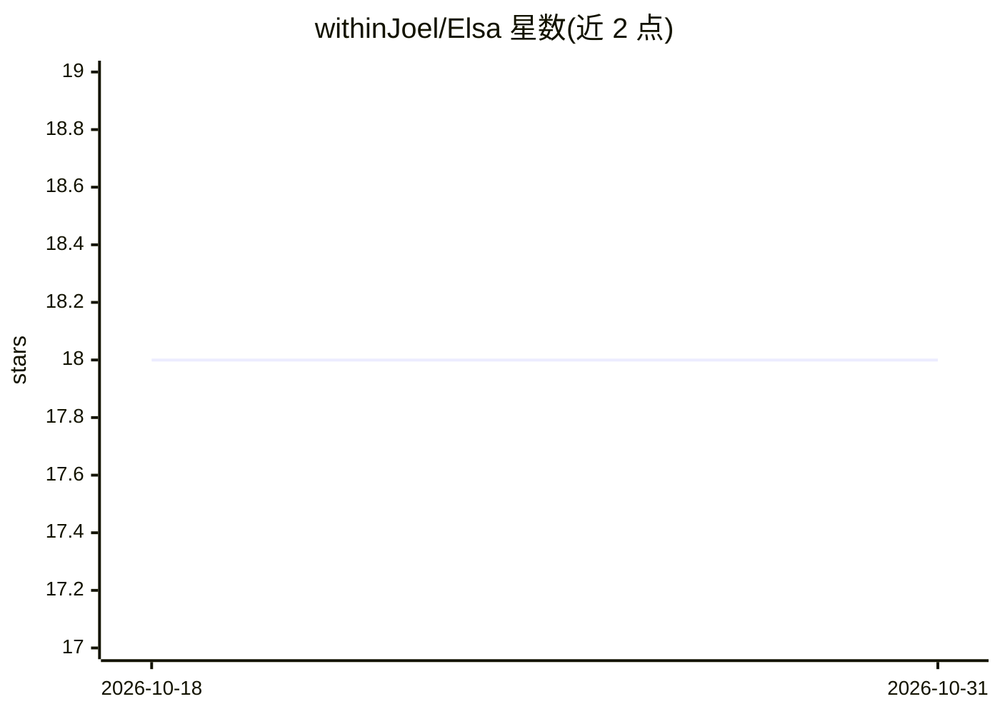

# withinJoel/Elsa

⭐ 18 · JavaScript · Apache-2.0 · 推送 2026-10-30 · [GitHub](https://github.com/withinJoel/Elsa) · [官网](https://elsaai.vercel.app) · 个人维护

**终端里的网页浏览器，带 AI 检测与编程语言功能**

由 Joel Jolly 开发的终端式网页浏览器，以命令行方式浏览网页，提供网页搜索、隐私防护、40+ 数学函数、网站快捷方式与开发者/网络工具。AI 部分为检测功能，可识别人物、裸露、性别等。安装方式为从 Elsa foundation 下载安装包后在 Windows 上运行（路径为 Program Files 下的 Elsa.exe）。文档提供语法说明，授权为 MIT。

## 筛选速览

| 维度 | 判定 | 备注 |
|---|---|---|
| AI 角色 | `ai-enhanced` | 去掉 AI 部分产品仍成立 |
| 许可风险 | `permissive` | Apache-2.0 |
| 部署形态 | `desktop` | 安装包/桌面程序 |
| 模型依赖 | — | README 未给出锁定关系 |
| 硬件要求 | — | 无带数字的原话,不猜 |
| 安装摩擦 | `medium` | 含编译或系统依赖之一 |
| 成熟度 | — | 结构信号不足 |

## 能力要点

- 终端式网页浏览与网站快捷方式
- 40+ 数学函数与开发者/网络工具
- AI 检测：识别人物、裸露、性别等
- 可在浏览器中运行或作为独立应用

## 适用场景

- 在终端中以命令行方式浏览网页
- 浏览时对页面内容做人像/裸露等检测
- 在浏览器或独立应用两种模式下使用

## 场景标签

`目标检测` · 领域:感知与多模态

## 证据(README 行号)

> L15: Are you a terminal enthusiast who also loves browsing the web? Do you often find yourself wishing you could combine
> L23: - **Detect humans, nudity, gender, and much more – because who doesn’t want a browser with superpowers?** 🦸

## 星数曲线

2026-10-18 18 → 2026-10-31 18（+0）

---
*卡片 v1 · prompt 1.4 · 生成 2026-10-29 · 置信度 high · 依据 README sha `7e38f5aaa5f7` · [字段定义](../../DATASET.md)*
