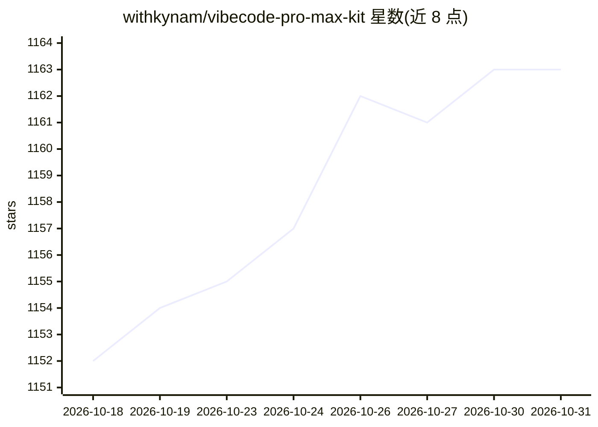

# withkynam/vibecode-pro-max-kit

⭐ 1,163 · JavaScript · MIT · 推送 2026-06-21 · [GitHub](https://github.com/withkynam/vibecode-pro-max-kit) · 组织维护

**给 AI 编程 agent 装上计划优先流程与记忆的开发套件**

面向使用 Claude Code、Codex、Cursor 等 AI 编程工具的开发者与产品负责人的 agent 装具（harness）：通过一条 curl 命令安装到项目，注入 15 个专用 agent、33 个技能、10 个钩子与 22 个协议，以 RIPER-5 七阶段门控流程（研究→规格→计划→执行等）约束 agent 先规划后编码；提供 /goal 免手值守运行块、PVL/EVL 自修复检查循环、按阶段写盘的进度记忆与自更新项目知识。安装为 bash 脚本，需 Node.js≥22、git、bash 环境，Windows 需经 Git Bash 或 WSL 运行。

## 筛选速览

| 维度 | 判定 | 备注 |
|---|---|---|
| AI 角色 | `ai-ecosystem` | LLM/agent 周边工具 |
| 许可风险 | `permissive` | MIT |
| 部署形态 | `desktop` | 安装包/桌面程序 |
| 模型依赖 | — | README 未给出锁定关系 |
| 硬件要求 | — | 无带数字的原话,不猜 |
| 安装摩擦 | `low` | 无编译、无系统依赖或容器化 |
| 成熟度 | — | 结构信号不足 |

## 能力要点

- RIPER-5 七阶段门控工作流，抑制 agent 直接写代码
- /goal 块跨会话恢复免手自动运行
- 15 agents + 33 skills + 10 hooks + 36 validators 随装即用
- 进度与项目知识写盘，会话重置后可续跑

## 适用场景

- 让 AI 编程 agent 按规格与计划流程交付功能
- 长任务跨会话免手执行且不丢失上下文
- 产品负责人在写代码前审阅书面计划

## 场景标签

`Agent 框架` · 领域:Agent 开发

## 证据(README 行号)

> L26: *Drop this into any project. Your AI agent gets a complete plan-first dev process — 7 gated phases, self-healing ch
> L29:  🌐 Works everywhere Any tech stack, any language, and any AI coding agent — Claude Code, Codex, Cursor, Windsurf, C
> L173:  🔧 7 Tools Claude Code · Codex · Cursor · Windsurf · Antigravity · OpenCode · Copilot

## 星数曲线

2026-10-18 1,152 → 2026-10-31 1,163（+11）

---
*卡片 v1 · prompt 1.4 · 生成 2026-10-21 · 置信度 mid · 依据 README sha `e164f19bf611` · [字段定义](../../DATASET.md)*
