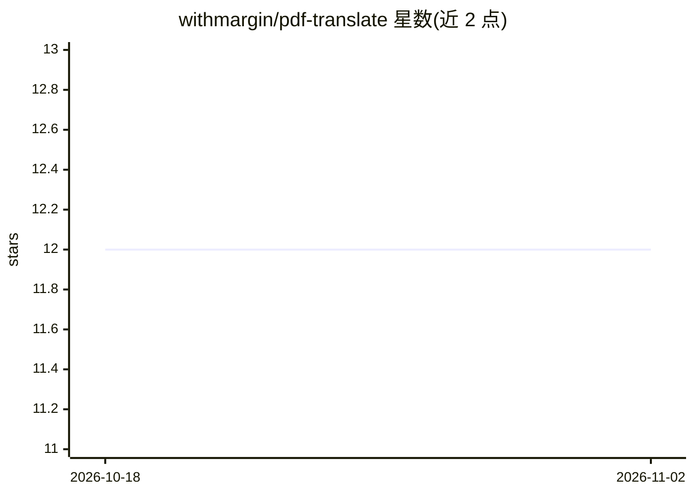

# withmargin/pdf-translate

⭐ 12 · Rust · MIT · 推送 2026-05-19 · [GitHub](https://github.com/withmargin/pdf-translate) · 组织维护

**用 LLM 翻译 PDF 并保留原排版的 CLI 工具**

Node.js/TypeScript 命令行工具，调用 LLM 逐页翻译 PDF 文本并回写原文件：用 Rust 库 pdf_oxide 提取带坐标/字体/颜色的文本片段，LLM 逐页翻译以避免上下文串扰，再通过内容流操作替换文本并内嵌 CJK 字体，背景、图片与形状保持不变。支持 OpenAI（默认）、Claude、Gemini 及任意 OpenAI 兼容 API。v0.1.0 存在已知限制：同行多片段可能出现间隙、无自动重排导致溢出、首次运行下载约 16MB CJK 字体。

## 筛选速览

| 维度 | 判定 | 备注 |
|---|---|---|
| AI 角色 | `ai-native` | 本体是模型或模型工具 |
| 许可风险 | `permissive` | MIT |
| 部署形态 | `library` | 以包/库形式分发 |
| 模型依赖 | locked-api |  |
| 硬件要求 | — | 无带数字的原话,不猜 |
| 安装摩擦 | `medium` | 含编译或系统依赖之一 |
| 成熟度 | `idea` | |

## 能力要点

- 翻译后仅替换文本，背景/图片/形状/Logo 原样保留
- 逐页独立翻译防止上下文串扰
- 支持 OpenAI/Claude/Gemini 及任意 OpenAI 兼容 API（自定义 base-url）
- npm 全局安装或 npx 直接运行，无需安装

## 适用场景

- 把 PDF 文档翻译成中文且保留原始排版
- 通过自定义 base-url 接入自选的 OpenAI 兼容翻译服务
- 批量处理需要保持版式的本地化文档

## 场景标签

`AI 写作` · 领域:内容生成

## 证据(README 行号)

> L7: Translate PDF documents using LLMs. Supports OpenAI, Claude, Gemini, and any OpenAI-compatible API.
> L44: 2. **Translate** — LLM translates each page independently (page-by-page to prevent context bleeding)

## 星数曲线

2026-10-18 12 → 2026-11-02 12（+0）

---
*卡片 v1 · prompt 1.4 · 生成 2026-10-31 · 置信度 high · 依据 README sha `6d2276039f91` · [字段定义](../../DATASET.md)*
