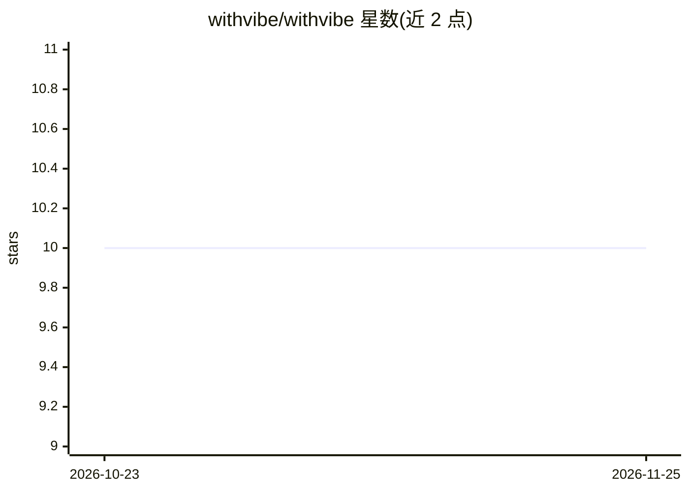

# withvibe/withvibe

⭐ 10 · TypeScript · AGPL-3.0 · 推送 2026-10-24 · [GitHub](https://github.com/withvibe/withvibe) · [官网](https://withvibe.dev) · 组织维护

**研发团队自托管的共享 AI 编码环境平台**

面向研发团队的自托管服务器栈：成员一键启动带现有代码的隔离环境，在环境中以 AI 为主要协作者进行编码，团队共享同一 AI 会话；合并前由专项 agent（安全、代码审查、测试、策略）作为自动闸门运行。仓库为 pnpm monorepo，含 Next.js 前端与 NestJS API，通过 npm 发布的 CLI 安装运行整个栈，依赖 Node 20+、Docker 24+ 与 PostgreSQL。

## 筛选速览

| 维度 | 判定 | 备注 |
|---|---|---|
| AI 角色 | `ai-ecosystem` | LLM/agent 周边工具 |
| 许可风险 | `dual` | AGPL-3.0 |
| 部署形态 | `self-host` | docker 或自建部署 |
| 模型依赖 | locked-api |  |
| 硬件要求 | — | 无带数字的原话,不猜 |
| 安装摩擦 | `low` | 无编译、无系统依赖或容器化 |
| 成熟度 | — | 结构信号不足 |

## 能力要点

- 一键启动预置现有代码的隔离开发环境
- 团队共享同一 AI 会话，无需各自 fork
- 合并前安全/代码审查/测试/策略 agent 自动闸门
- 支持插件扩展（MCP 服务器驱动的看板等）

## 适用场景

- 研发团队内部自托管共享的 AI 编码环境
- 用专项 agent 在合并前做自动化质量闸门
- 多人协作同一个 AI 会话进行 vibe coding

## 场景标签

`编码 Agent` `代码审查` · 领域:编码与开发

## 证据(README 行号)

> L3: **A self-hosted, shared AI environment for R&D teams.**
> L42: - **Vibecode with AI.** The AI is the primary collaborator inside the env.
> L44: - **Automated gate before prod.** Once humans approve, specialist agents (security, code review, tests, policy) run

## 星数曲线

2026-10-23 10 → 2026-11-25 10（+0）

---
*卡片 v1 · prompt 1.4 · 生成 2026-11-19 · 置信度 high · 依据 README sha `57e63b98c507` · [字段定义](../../DATASET.md)*
