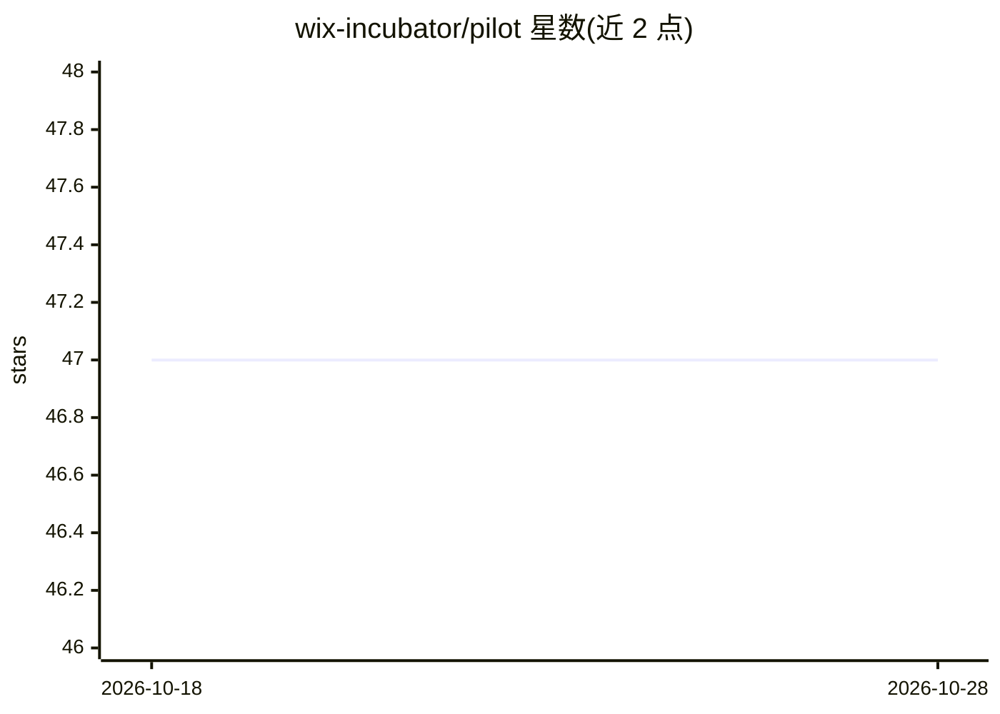

# wix-incubator/pilot

⭐ 47 · HTML · MIT · 推送 2026-02-08 · [GitHub](https://github.com/wix-incubator/pilot) · [官网](http://wix-pilot.com/) · 组织维护

**用自然语言指令驱动自动化测试的 LLM 测试框架**

Wix Pilot 是 AI 驱动的测试框架，将人类可读的自然语言指令翻译为具体测试动作。最初为 Detox 设计，现通过驱动包支持 Puppeteer、Playwright、Appium(WebDriverIO) 等多平台。用户需自行实现 PromptHandler 以接入 LLM 服务；提供 perform API 执行测试步骤序列，以及 autopilot 自主测试模式（输出逐步执行报告与 Beta 状态的 UX/可访问性/i18n 评审）。以 npm 包形式分发，面向自动化测试开发者。

## 筛选速览

| 维度 | 判定 | 备注 |
|---|---|---|
| AI 角色 | `ai-ecosystem` | LLM/agent 周边工具 |
| 许可风险 | `permissive` | MIT |
| 部署形态 | `library` | 以包/库形式分发 |
| 模型依赖 | — | README 未给出锁定关系 |
| 硬件要求 | — | 无带数字的原话,不猜 |
| 安装摩擦 | `low` | 无编译、无系统依赖或容器化 |
| 成熟度 | `idea` | |

## 能力要点

- 自然语言编写的测试指令由 LLM 翻译为框架动作
- 通过驱动包支持 Detox/Puppeteer/Playwright/Appium 多平台
- autopilot 自主测试模式输出步骤报告与改进建议（UX/a11y/i18n 为 Beta）
- 用户实现 PromptHandler 接入自选 LLM 服务

## 适用场景

- 用英文或任意语言编写 Web/Mobile 自动化测试
- 让 LLM 将人类可读测试用例转为 Detox/Playwright 等框架动作
- 自主模式下对功能页面执行测试并获得 UX 与可访问性评审

## 场景标签

`浏览器自动化` · 领域:效率与自动化

## 证据(README 行号)

> L5: Wix Pilot is an AI-powered testing framework that translates human-readable commands into precise testing actions. O
> L11: - **AI-Enhanced**: Powered by LLMs for intelligent test interpretation

## 星数曲线

2026-10-18 47 → 2026-10-28 47（+0）

---
*卡片 v1 · prompt 1.4 · 生成 2026-10-25 · 置信度 high · 依据 README sha `9c178bd75707` · [字段定义](../../DATASET.md)*
