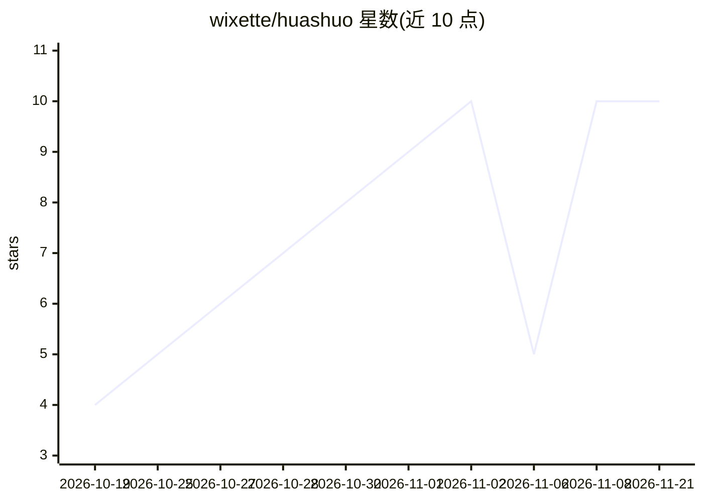

# wixette/huashuo

⭐ 10 · Python · Apache-2.0 · 推送 2026-10-25 · [GitHub](https://github.com/wixette/huashuo) · 个人维护 · 中文 README

**在 Apple Silicon Mac 上把中文小说做成多角色有声书**

话说（Huashuo）读取中文小说 TXT/EPUB，先用 LLM 标注每句对白的说话人，按角色性别、年龄、性格从 16 种中文声音中分配配音，再用 Qwen3-TTS（经 MLX）在本机合成语音，输出带章节、封面的 M4B，也可导出 MP3。合成后用语音识别自动核对漏读错读并重做。仅支持 Apple Silicon Mac，当前需从源码安装；多角色模式需配置 LLM（云端或本机），不用 LLM 时可单声旁白朗读。

## 筛选速览

| 维度 | 判定 | 备注 |
|---|---|---|
| AI 角色 | `ai-native` | 本体是模型或模型工具 |
| 许可风险 | `permissive` | Apache-2.0 |
| 部署形态 | `library` | 以包/库形式分发 |
| 模型依赖 | local-ok | 支持本地模型 |
| 硬件要求 | — | 无带数字的原话,不猜 |
| 安装摩擦 | `medium` | 含编译或系统依赖之一 |
| 成熟度 | — | 结构信号不足 |

## 能力要点

- LLM 说话人标注 + 按角色属性自动配音（16 种中文声音）
- Qwen3-TTS 通过 MLX 在 Apple Silicon 本机合成，音频不经服务器
- 合成后语音识别自动核对，问题片段自动/指定时间点重新合成
- 工作目录内 cast.json、pron.txt 等可手工修改后增量重合成

## 适用场景

- 把中文小说转成可在 Apple Books 收听的多角色有声书
- 本机模型全流程离线零费用制作有声书
- 为自出版作品批量生成有声版

## 场景标签

`语音合成` · 领域:内容生成

## 证据(README 行号)

> L13: 话说（Huashuo）把中文小说（TXT、EPUB）做成多角色有声书：先由 LLM 找出每句对白是谁说的，再按角色的性别、年龄和性格为每个人挑一个合适的声音，用 Qwen3-TTS 在 Mac 本机合成语音，最后生成带章节、封面的
> L39: - **本机合成**：Qwen3-TTS 通过 MLX 在 Apple Silicon 上运行，音频不经过任何服务器
> L50: - 只支持 Apple Silicon Mac（M1 或更新的芯片，建议 16 GB 以上内存），需要从源码安装；命令行界面只有英文

## 星数曲线

2026-10-19 4 → 2026-11-21 10（+6）

---
*卡片 v1 · prompt 1.4 · 生成 2026-11-19 · 置信度 high · 依据 README sha `463900b5f09b` · [字段定义](../../DATASET.md)*
