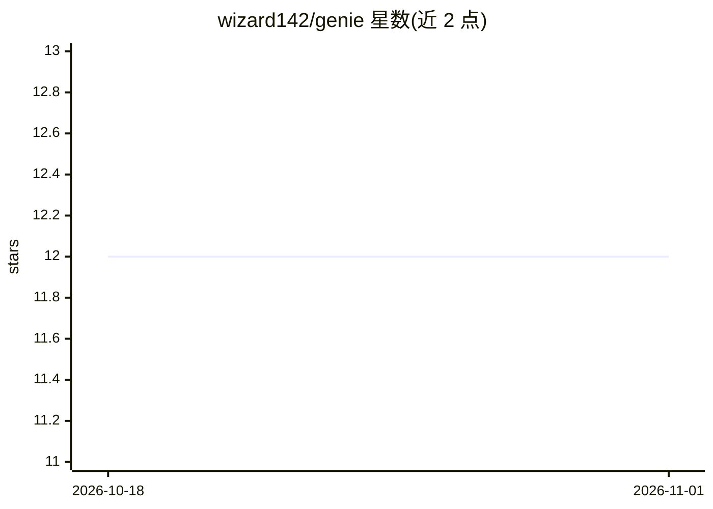

# wizard142/genie

⭐ 12 · Python · MIT · 推送 2026-10-06 · [GitHub](https://github.com/wizard142/genie) · 个人维护

**把英文愿望翻译成真实 Linux/Windows 命令的确认式终端工具**

面向终端新手的 CLI 工具：以 /genie 前缀输入英文，工具展示对应的真实命令与一行解释，确认后才执行；删除/覆写类命令需输入 yes，灾难性命令（rm -rf / 等）无条件拦截，删除走回收站/gio trash。AI 部分支持 Groq、Gemini、OpenRouter、Claude、Ollama 多提供商并自动故障转移，常见任务（装应用、更新、查磁盘/内存）内置离线完成无需 AI。单 Python 文件、零 pip 依赖，通过 git clone 加安装脚本安装，支持 8 种 Linux 包管理器发行版与 Windows 10/11。

## 筛选速览

| 维度 | 判定 | 备注 |
|---|---|---|
| AI 角色 | `ai-native` | 本体是模型或模型工具 |
| 许可风险 | `permissive` | MIT |
| 部署形态 | `library` | 以包/库形式分发 |
| 模型依赖 | local-ok | 支持本地模型 |
| 硬件要求 | — | 无带数字的原话,不猜 |
| 安装摩擦 | `low` | 无编译、无系统依赖或容器化 |
| 成熟度 | — | 结构信号不足 |

## 能力要点

- 自然语言转真实命令，展示、解释、确认后才运行
- 四级安全分级，灾难性命令无条件拦截，删除走回收站
- 多 AI 提供商配置与自动故障转移，密钥即贴即测
- 安装/更新/硬件查询等常见任务离线内置，无需 API key

## 适用场景

- 不记得命令时用英文让终端替我执行
- 学 Linux 命令：每次看到真实命令和解释
- 配置多个免费 AI 提供商应对限流

## 场景标签

`AI 助手` · 领域:对话与助手

## 证据(README 行号)

> L9: Type `/genie install teams for me`. genie shows you the real command, tells you what it does, and runs it once you s
> L34: You pick the AI: Groq, Google Gemini, and OpenRouter all have free tiers, Anthropic Claude is paid, and Ollama runs

## 星数曲线

2026-10-18 12 → 2026-11-01 12（+0）

---
*卡片 v1 · prompt 1.4 · 生成 2026-10-31 · 置信度 mid · 依据 README sha `73011118791b` · [字段定义](../../DATASET.md)*
