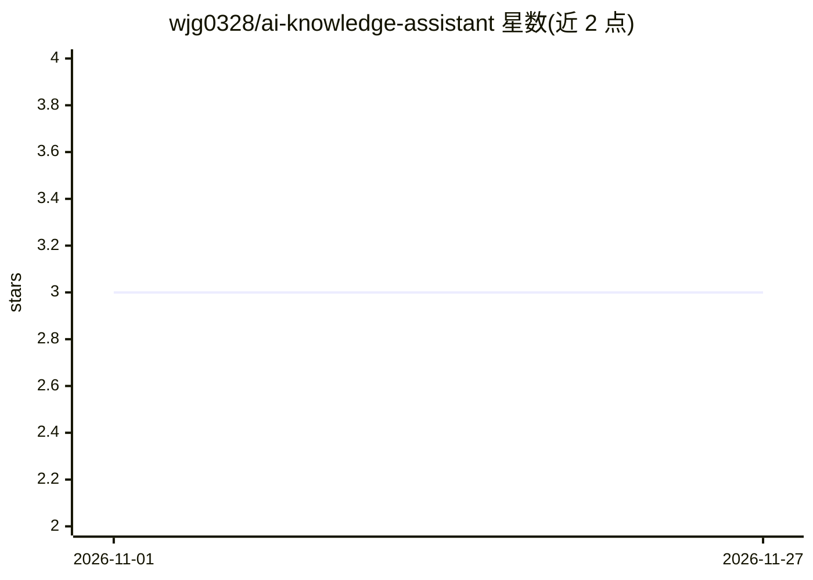

# wjg0328/ai-knowledge-assistant

⭐ 3 · Python · 推送 2026-10-31 · [GitHub](https://github.com/wjg0328/ai-knowledge-assistant) · 个人维护 · 中文 README

**Python+Streamlit 的个人知识库 RAG 问答教学项目**

以学习为导向的 Python 应用案例：导入 TXT/Markdown/文字型 PDF 后分块，默认用 TF-IDF 做离线检索并展示原文摘录；配置兼容 Chat Completions 接口后切换为流式生成问答，可选 Embeddings API 加 Chroma 做语义检索。数据用 SQLite 明文本地存储，默认仅监听 127.0.0.1，无登录与多会话，定位为本机单用户教学项目，配套手敲教程与 pytest/ruff 检查，由 GitHub Copilot 辅助开发。

## 筛选速览

| 维度 | 判定 | 备注 |
|---|---|---|
| AI 角色 | `ai-native` | 本体是模型或模型工具 |
| 许可风险 | `none` | — |
| 部署形态 | `None` |  |
| 模型依赖 | — | README 未给出锁定关系 |
| 硬件要求 | — | 无带数字的原话,不猜 |
| 安装摩擦 | `low` | 无编译、无系统依赖或容器化 |
| 成熟度 | — | 结构信号不足 |

## 能力要点

- 默认无需密钥的离线 TF-IDF 检索模式
- OpenAI SDK 兼容接口的流式生成问答，Base URL 可自定义
- 可选 Embeddings API + Chroma 语义向量检索，向量可从 SQLite 重建
- 无检索证据时跳过模型调用，展示引用块位置与 Token 用量

## 适用场景

- 逐步手敲复现一个完整 RAG 应用作为学习练习
- 在本机对个人文档做检索问答
- 对比词法检索（TF-IDF）与语义检索的召回差异

## 场景标签

`RAG` `教程课程` · 领域:知识与检索

## 证据(README 行号)

> L3: 一个适合逐步手敲的 Python AI 应用案例。默认无需密钥即可运行离线检索；配置模型服务后支持流式生成式问答。
> L9: - 文本分块、字符级 TF-IDF 检索；可选使用兼容 Embeddings API 的服务与 Chroma 做语义向量检索。
> L110: - 这是本机单用户教学项目，默认仅监听 `127.0.0.1`，无登录、权限隔离或多会话管理。不要直接开放到公网。
> L120: - 未包含 Agent、工具调用、微调或生产部署；这些应作为学懂本项目后的独立扩展。

## 星数曲线

2026-11-01 3 → 2026-11-27 3（+0）

---
*卡片 v1 · prompt 1.4 · 生成 2026-11-21 · 置信度 high · 依据 README sha `545af690d8cb` · [字段定义](../../DATASET.md)*
