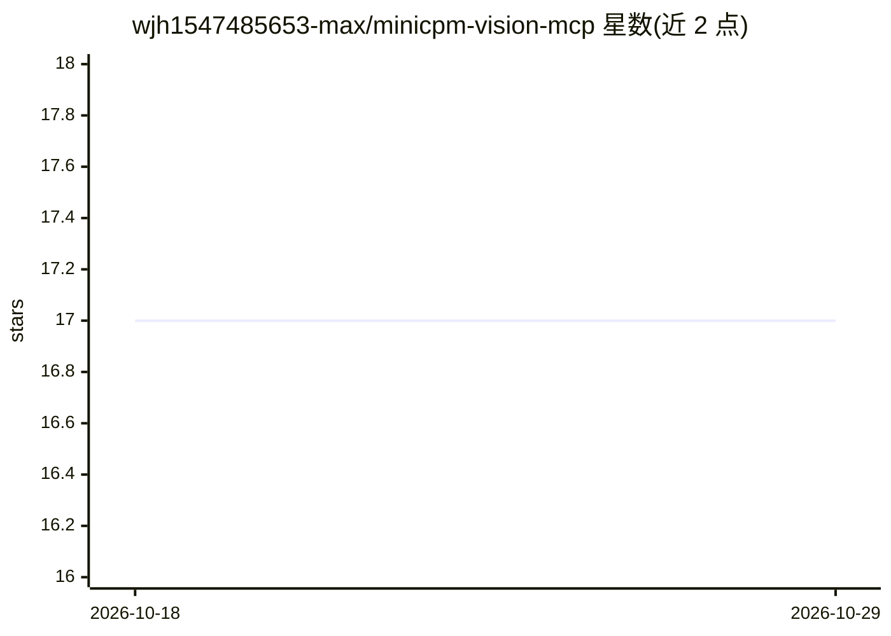

# wjh1547485653-max/minicpm-vision-mcp

⭐ 17 · JavaScript · MIT · 推送 2026-06-26 · [GitHub](https://github.com/wjh1547485653-max/minicpm-vision-mcp) · 个人维护 · 中文 README

**本地视觉+音频 MCP 服务器：给纯文本模型加图片/视频/音频理解**

基于 Ollama + MiniCPM-V 4.6 + faster-whisper 的本地 MCP 服务器，向 DeepSeek 等单模态大模型提供三个工具：describe_image 输出中文图片描述；describe_video 下载视频后用 FFmpeg 提取关键帧、逐帧分析并汇总，分析完自动删除文件；describe_audio 用 faster-whisper 做语音转文字。数据完全本地处理。以单文件 Node 脚本提供，需先安装 Ollama 并拉取模型，可接入 Claude Desktop、Reasonix 等 MCP 客户端。README 含与同类项目的功能对比表。

## 筛选速览

| 维度 | 判定 | 备注 |
|---|---|---|
| AI 角色 | `ai-ecosystem` | LLM/agent 周边工具 |
| 许可风险 | `permissive` | MIT |
| 部署形态 | `library` | 以包/库形式分发 |
| 模型依赖 | local-ok | 支持本地模型 |
| 硬件要求 | — | 无带数字的原话,不猜 |
| 安装摩擦 | `medium` | 含编译或系统依赖之一 |
| 成熟度 | — | 结构信号不足 |

## 能力要点

- 三个 MCP 工具：图片中文描述、视频关键帧时间线分析、faster-whisper 语音转文字
- 视频分析完成后自动清理文件
- 完全本地运行，数据不出机
- MiniCPM 原生中文内容理解

## 适用场景

- 让 DeepSeek 等纯文本模型看懂截图、照片和视频
- 提取视频中的语音并转为文字
- 敏感图片/视频在本地处理，不上传数据

## 场景标签

 · 领域:LLM 基础设施/多模态工具

## 证据(README 行号)

> L3: 为 **DeepSeek V4.0 等单模态大模型** 装上眼睛和耳朵 —— 本地运行的视觉+音频 MCP 服务器，基于 **Ollama + MiniCPM-V 4.6 + faster-whisper**。
> L5: > 图片描述 · 视频帧分析 · 音频语音转文字 · 完全本地 · 数据不出机

## 星数曲线

2026-10-18 17 → 2026-10-29 17（+0）

---
*卡片 v1 · prompt 1.4 · 生成 2026-10-29 · 置信度 high · 依据 README sha `51bfeeaea152` · [字段定义](../../DATASET.md)*
