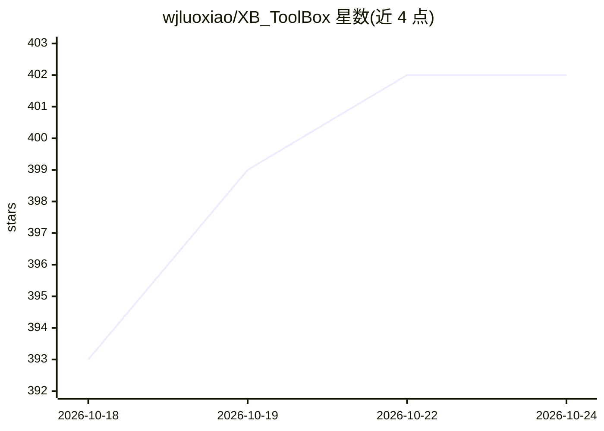

# wjluoxiao/XB_ToolBox

⭐ 402 · Python · Apache-2.0 · 推送 2026-10-23 · [GitHub](https://github.com/wjluoxiao/XB_ToolBox) · [官网](https://space.bilibili.com/302329373) · 个人维护 · 中文 README

**面向 AMD GPU 的 ComfyUI 自定义节点套件：141 节点+显存优化**

ComfyUI 扩展套件，帮助 AI 新手掌握工作流并简化本地部署，覆盖前端交互与底层显存调度。包含 141 个节点：统一参数管理、显存优化（Block Swap、SageAttention、GGUF 加载器、缓存分层清理）、长视频接力分段生成、Wan 视频节点族、CosyVoice3 语音、本地 LLM 提示词套件（XB-llama，支持本地模型与在线 API 后端）、音频切片、人像分割、漫画对白、硬件监控面板与 YuE2 音乐节点。优化面向消费级 GPU 运行 14B~22B 3D-DiT 视频模型，人像分割在 AMD 上走 DirectML GPU 路径。

## 筛选速览

| 维度 | 判定 | 备注 |
|---|---|---|
| AI 角色 | `ai-ecosystem` | LLM/agent 周边工具 |
| 许可风险 | `permissive` | Apache-2.0 |
| 部署形态 | `library` | 以包/库形式分发 |
| 模型依赖 | — | README 未给出锁定关系 |
| 硬件要求 | — | 无带数字的原话,不猜 |
| 安装摩擦 | `medium` | 含编译或系统依赖之一 |
| 成熟度 | — | 结构信号不足 |

## 能力要点

- 141 个节点，计数直接读取 __init__.py 的 NODE_CLASS_MAPPINGS
- 显存优化（Block Swap / GGUF 加载器 / 分层缓存清理）支持消费级 GPU 运行 14B~22B 视频模型
- Param Bus + Relay 接力模式分段生成长视频，避免单次 OOM
- 本地 LLM 提示词套件支持本地模型与在线 API 双后端，API key 不写入工作流

## 适用场景

- 在 ComfyUI 中用统一面板管理图像/视频参数，减少连线
- 低显存 AMD 消费级 GPU 上运行大参数视频生成模型
- 分段接力生成长视频/数字人内容并进行音频与语音处理
- 用本地 LLM 增强或反推提示词

## 场景标签

 · 领域:AI 图像/视频生成工具链

## 证据(README 行号)

> L7: The primary goal of **XB_ToolBox** is to help AI beginners new to ComfyUI quickly master workflows, making local dep
> L23: ## 🗺️ What's inside — 141 nodes

## 星数曲线

2026-10-18 393 → 2026-10-24 402（+9）

---
*卡片 v1 · prompt 1.4 · 生成 2026-10-21 · 置信度 mid · 依据 README sha `89cbb00dfa0f` · [字段定义](../../DATASET.md)*
