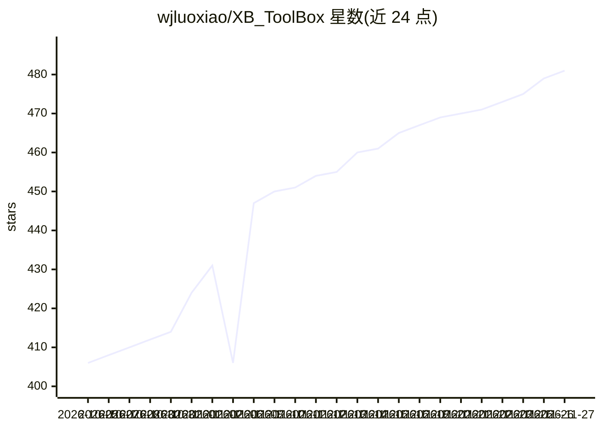

# wjluoxiao/XB_ToolBox

⭐ 481 · Python · Apache-2.0 · 推送 2026-11-25 · [GitHub](https://github.com/wjluoxiao/XB_ToolBox) · [官网](https://space.bilibili.com/302329373) · 个人维护 · 中文 README

**面向 ComfyUI 新手的 141 节点工具集，主打 AMD GPU 显存优化**

一套 ComfyUI 自定义节点套件，含 141 个节点，覆盖参数集中管理、显存优化（分层清理、Block Swap、GGUF 加载器、SageAttention）、长视频分段接力、Wan 系列视频节点重实现、音频切片与 CosyVoice3 语音、本地 LLM 提示词工具（XB-llama）等。定位为帮助 AI 新手掌握 ComfyUI 工作流，通过时空分块劫持与动态显存卸载让消费级 GPU 运行 14B~22B 视频模型。面向 AMD ROCm 生态做实验性内核优化，节点数来自 __init__.py 的 NODE_CLASS_MAPPINGS。

## 筛选速览

| 维度 | 判定 | 备注 |
|---|---|---|
| AI 角色 | `ai-ecosystem` | LLM/agent 周边工具 |
| 许可风险 | `permissive` | Apache-2.0 |
| 部署形态 | `library` | 以包/库形式分发 |
| 模型依赖 | local-ok | 支持本地模型 |
| 硬件要求 | — | 无带数字的原话,不猜 |
| 安装摩擦 | `medium` | 含编译或系统依赖之一 |
| 成熟度 | — | 结构信号不足 |

## 能力要点

- 141 个节点，含 25 个 VRAM 优化节点（分层清理/Block Swap/GGUF/SageAttention）
- 长视频接力机制：Param Bus + Relay 节点分段执行避免单次 OOM
- 本地 LLM 与在线 API 双后端的提示词增强/反推节点组
- 镜像克隆控制台将复杂工作流节点聚合为统一面板

## 适用场景

- 在消费级 AMD GPU 上运行大型视频生成模型
- 把长视频生成拆分为接力段规避显存不足
- 为 ComfyUI 工作流做参数集中管理与可视化教学
- 本地运行 LLM 做提示词增强与故事板生成

## 场景标签

`图像生成` `视频生成` `模型量化` · 领域:内容生成

## 证据(README 行号)

> L7: The primary goal of **XB_ToolBox** is to help AI beginners new to ComfyUI quickly master workflows, making local dep
> L12: - **Extreme VRAM Optimization:** Through "Spatiotemporal Chunk Hijacking", "Dynamic VRAM Offloading for UNet/Checkp

## 星数曲线

2026-10-25 406 → 2026-11-27 481（+75）

---
*卡片 v1 · prompt 1.4 · 生成 2026-11-25 · 置信度 low · 依据 README sha `10ed17f03587` · [字段定义](../../DATASET.md)*
