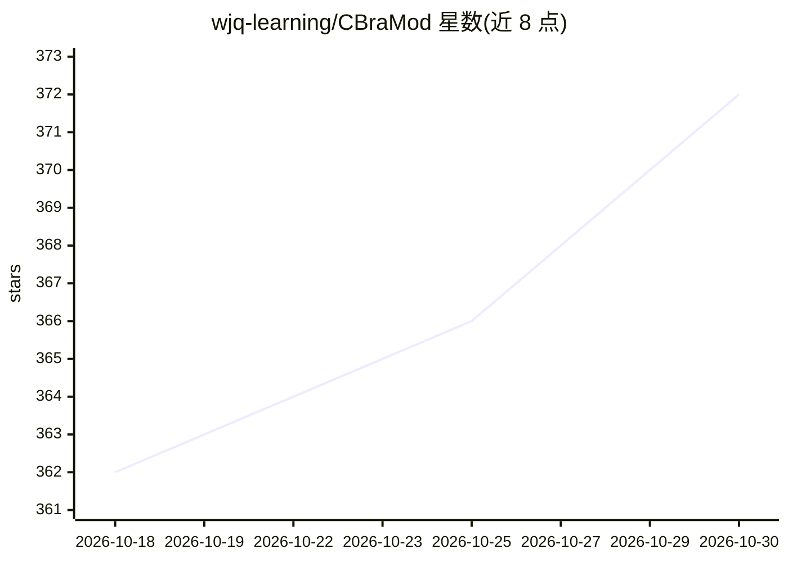

# wjq-learning/CBraMod

⭐ 372 · Python · MIT · 推送 2026-08-07 · [GitHub](https://github.com/wjq-learning/CBraMod) · [官网](https://openreview.net/forum?id=NPNUHgHF2w) · 组织维护

**面向 EEG 解码的脑电基础模型（ICLR 2025），含预训练权重**

CBraMod 是发表于 ICLR 2025 的 EEG 基础模型论文官方代码库，面向临床与 BCI 应用场景的脑电解码研究。提供预训练脚本 pretrain_main.py、微调脚本 finetune_main.py，并在 Hugging Face 上发布预训练 checkpoint。安装需先装 Python 与 PyTorch，再 pip install -r requirements.txt；可通过 Quick Start 示例代码加载模型在自定义下游数据集上微调。README 声明代码仍在持续改进以形成标准化流程。

## 筛选速览

| 维度 | 判定 | 备注 |
|---|---|---|
| AI 角色 | `ai-native` | 本体是模型或模型工具 |
| 许可风险 | `permissive` | MIT |
| 部署形态 | `library` | 以包/库形式分发 |
| 模型依赖 | — | README 未给出锁定关系 |
| 硬件要求 | — | 无带数字的原话,不猜 |
| 安装摩擦 | `low` | 无编译、无系统依赖或容器化 |
| 成熟度 | — | 结构信号不足 |

## 能力要点

- Criss-Cross 结构的 EEG 基础模型，覆盖临床与 BCI 应用
- 提供预训练与微调脚本
- 在 Hugging Face 发布预训练 checkpoint
- 支持在自定义下游数据集上微调的示例代码

## 适用场景

- 在自有 EEG 数据集上微调做下游解码任务
- 复现论文的预训练与微调流程
- 基于公开 checkpoint 开展脑电研究

## 场景标签

`微调` `模型训练` · 领域:训练与推理

## 证据(README 行号)

> L22: We propose **CBraMod**, a novel EEG foundation model, for EEG decoding on various clinical and BCI application.
> L19: 🔥 NEWS: The paper "_CBraMod: A Criss-Cross Brain Foundation Model for EEG Decoding_" has been accepted by ICLR 2025

## 星数曲线

2026-10-18 362 → 2026-10-30 372（+10）

---
*卡片 v1 · prompt 1.4 · 生成 2026-10-21 · 置信度 mid · 依据 README sha `319163642308` · [字段定义](../../DATASET.md)*
