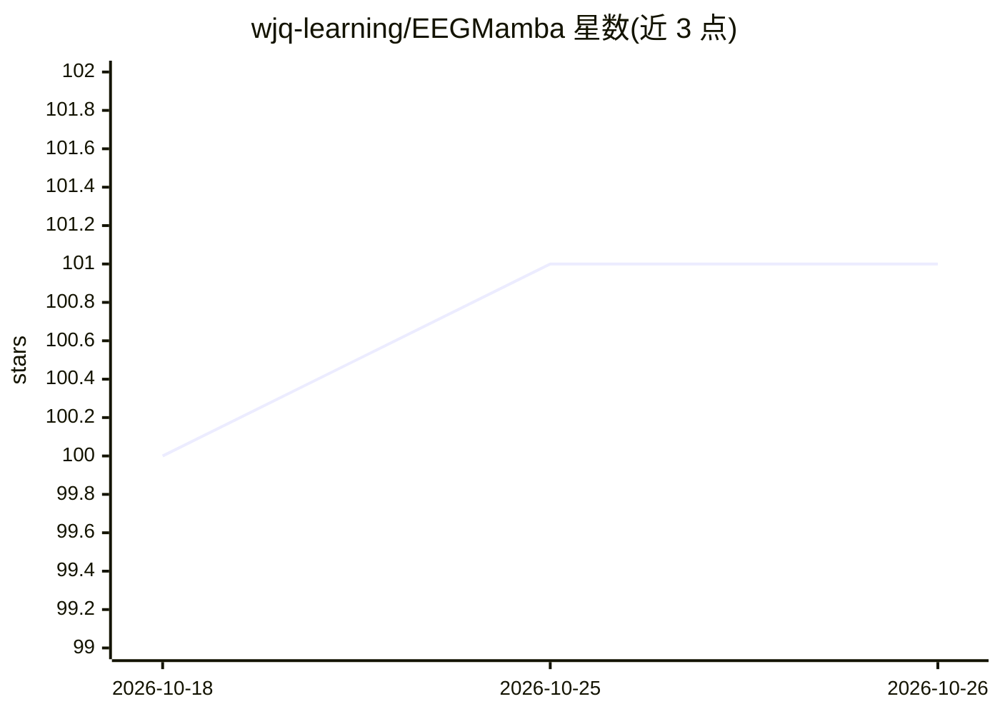

# wjq-learning/EEGMamba

⭐ 101 · Python · MIT · 推送 2025-11-17 · [GitHub](https://github.com/wjq-learning/EEGMamba) · [官网](https://www.sciencedirect.com/science/article/pii/S0893608025006963) · 组织维护

**面向临床与 BCI 的 EEG 基础模型（Mamba 架构）及预训练/微调代码**

EEGMamba 是基于 Mamba 状态空间模型的脑电（EEG）基础模型，用于多种临床与脑机接口应用的 EEG 解码任务，论文被 Neural Networks 接收。仓库基于 CBraMod 代码实现，提供预训练与微调脚本，在 Hugging Face 上发布预训练 checkpoint；除论文评估的 6 个下游数据集外，还提供 CBraMod 论文所用全部下游数据集的评估代码，供社区进一步评测。安装需 Python、PyTorch 与 Mamba，再 pip 安装 requirements。

## 筛选速览

| 维度 | 判定 | 备注 |
|---|---|---|
| AI 角色 | `ai-native` | 本体是模型或模型工具 |
| 许可风险 | `permissive` | MIT |
| 部署形态 | `library` | 以包/库形式分发 |
| 模型依赖 | — | README 未给出锁定关系 |
| 硬件要求 | — | 无带数字的原话,不猜 |
| 安装摩擦 | `low` | 无编译、无系统依赖或容器化 |
| 成熟度 | — | 结构信号不足 |

## 能力要点

- 基于 Mamba 状态空间模型的 EEG 基础模型
- 提供预训练与微调脚本（pretrain_main.py / finetune_main.py）
- Hugging Face 发布预训练 checkpoint
- 覆盖 CBraMod 论文全部下游数据集的评估代码

## 适用场景

- 在自定义下游 EEG 数据集上微调预训练模型
- 复现或扩展 EEGMamba 论文的下游评测
- 临床或脑机接口场景的 EEG 解码研究

## 场景标签

`模型训练` `微调` `模型评测` · 领域:评测与运维

## 证据(README 行号)

> L25: We propose **EEGMamba**, a novel EEG foundation model based on Mamba state space model, for EEG decoding on various
> L16: 💡 NOTING: This repository is implemented based on the CBraMod repository.

## 星数曲线

2026-10-18 100 → 2026-10-26 101（+1）

---
*卡片 v1 · prompt 1.4 · 生成 2026-10-23 · 置信度 high · 依据 README sha `dbda1652b987` · [字段定义](../../DATASET.md)*
