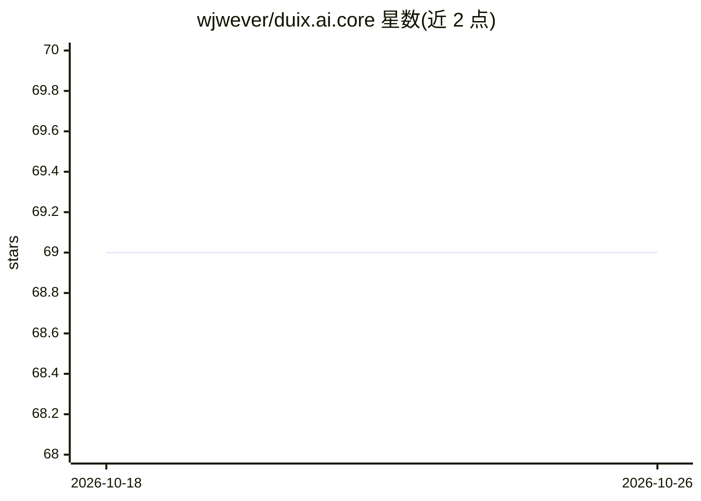

# wjwever/duix.ai.core

⭐ 69 · C++ · NOASSERTION · 推送 2025-11-13 · [GitHub](https://github.com/wjwever/duix.ai.core) · 个人维护 · 中文 README

**轻量数字人（avatar）系统：语音对话驱动虚拟形象**

自托管的数字人系统：集成 VAD（silero-vad）、语音识别（SenseVoice）、TTS（minimax）与大语言模型（默认 kimi，可通过修改 config.json 的 API 地址切换 deepseek 等其他模型），形象资源来自 GuijiAI/duix.ai。README 提供源码克隆（含子模块）方式安装，测试环境为 Ubuntu 22.04，macOS 未测试；TODO 中列出优化 docker 工作流，docker 支持尚在待办。

## 筛选速览

| 维度 | 判定 | 备注 |
|---|---|---|
| AI 角色 | `ai-native` | 本体是模型或模型工具 |
| 许可风险 | `none` | NOASSERTION |
| 部署形态 | `None` |  |
| 模型依赖 | — | README 未给出锁定关系 |
| 硬件要求 | — | 无带数字的原话,不猜 |
| 安装摩擦 | `low` | 无编译、无系统依赖或容器化 |
| 成熟度 | — | 结构信号不足 |

## 能力要点

- 集成 VAD/ASR/TTS/LLM 的 avatar 对话链路
- LLM 后端可通过配置文件切换 API 地址（kimi/deepseek 等）
- 源码含子模块克隆安装，测试环境 Ubuntu 22.04

## 适用场景

- 自建语音对话数字人/虚拟形象
- 替换不同 LLM 后端搭建对话 avatar
- 在 Linux 服务器上运行低成本数字人系统

## 场景标签

`语音 Agent` · 领域:对话与助手

## 证据(README 行号)

> L9:  A light weight avatar, If you are interested in This project, please kindly give Me a triple `Star`, `Fork` and `Wa
> L15: * asr: SenseVoice
> L17: * lm: kimi now， it is easy to try deepseek and some other language models，just to change the api url in conf/config

## 星数曲线

2026-10-18 69 → 2026-10-26 69（+0）

---
*卡片 v1 · prompt 1.4 · 生成 2026-10-24 · 置信度 mid · 依据 README sha `4f6c303d81f2` · [字段定义](../../DATASET.md)*
