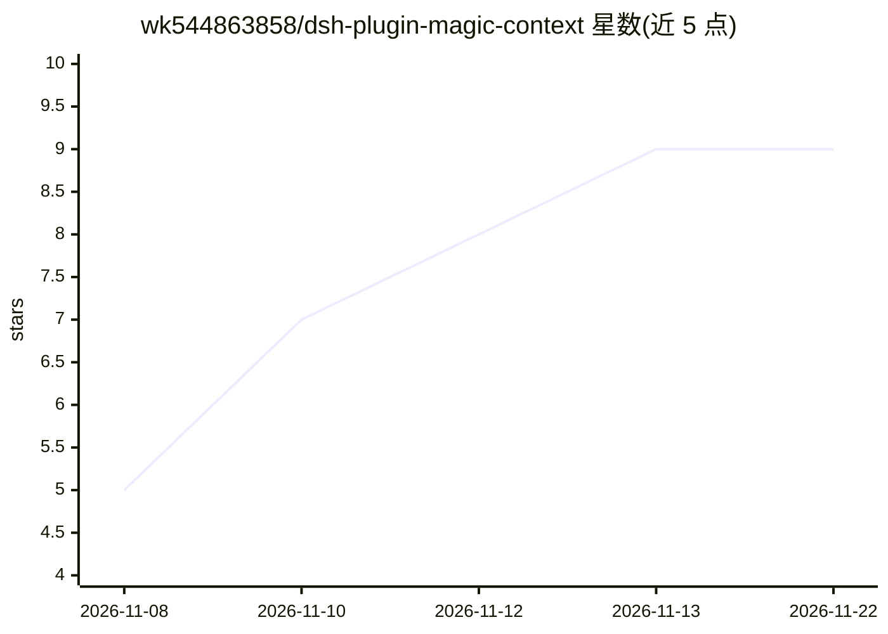

# wk544863858/dsh-plugin-magic-context

⭐ 9 · TypeScript · MIT · 推送 2026-11-11 · [GitHub](https://github.com/wk544863858/dsh-plugin-magic-context) · 个人维护 · 中文 README

**为 DSH 会话提供持久记忆与上下文回收的插件**

DeepSeek Harness（DSH）桌面端的插件：将项目知识沉淀到插件自有的 SQLite 语料库，提供全文 0.7 / 本地向量 0.3 的混合检索，并在模型读取位置重注入；同时把上下文窗口作为资产管理——工具输出打 `§N§` 标签后可逆回收（ctx_reduce 只排队、ctx_expand 还原原文），历史经 historian 摘要为 p1–p4 分层替换，压缩走可选的 compaction 接缝且默认关闭。要求 Node ≥ 22.19 与 DSH 0.2.x，包发布于 npm，含中文版 README。

## 筛选速览

| 维度 | 判定 | 备注 |
|---|---|---|
| AI 角色 | `ai-ecosystem` | LLM/agent 周边工具 |
| 许可风险 | `permissive` | MIT |
| 部署形态 | `library` | 以包/库形式分发 |
| 模型依赖 | locked-api |  |
| 硬件要求 | — | 无带数字的原话,不猜 |
| 安装摩擦 | `low` | 无编译、无系统依赖或容器化 |
| 成熟度 | — | 结构信号不足 |

## 能力要点

- SQLite 项目记忆库 + 全文/向量混合检索（MiniLM 经 WASM 本地运行，无原生构建、无 API key）
- 可逆上下文回收：占位符 `[dropped §N§]` 与 ctx_expand 原文还原，不破坏 KV-cache 前缀
- historian 带外摘要：单次 LLM 调用生成 p1–p4 四级总结，只写存储不动主链路
- 发布门禁：全局域 staging 可自动化，publishing 必须人工审批

## 适用场景

- 长会话跨天重启后找回已敲定的项目结论
- 控制工具输出导致的上下文膨胀而不丢失原文
- 多会话间共享项目记忆并保持缓存前缀稳定

## 场景标签

`Agent 记忆` · 领域:Agent 开发

## 证据(README 行号)

> L16: > persist, context should be managed.** This plugin gives **DeepSeek Harness (DSH)**
> L19: > re-injected right where the model reads it — while the context window itself is run as
> L90: |**Compaction seam**|`registerCompactionEngine` can take over `ctx.compaction` (real `compaction/start\|summary\|re

## 星数曲线

2026-11-08 5 → 2026-11-22 9（+4）

---
*卡片 v1 · prompt 1.4 · 生成 2026-11-20 · 置信度 high · 依据 README sha `ad46c61a711e` · [字段定义](../../DATASET.md)*
