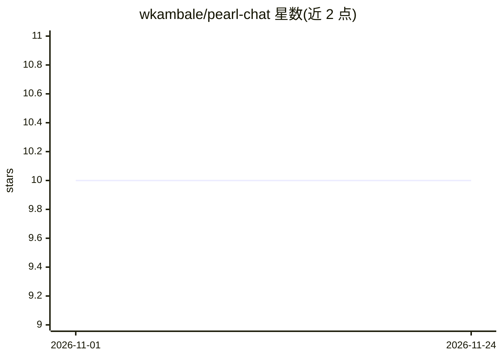

# wkambale/pearl-chat

⭐ 10 · Jupyter Notebook · MIT · 推送 2026-10-08 · [GitHub](https://github.com/wkambale/pearl-chat) · [官网](https://huggingface.co/kambale/pearl-chat) · 个人维护

**纯 JAX 从零实现的卢干达语小型因果语言模型**

以纯 JAX 与 Flax NNX 从零实现的 GPT-2 风格 decoder-only Transformer（约 8.5M 参数、8 层、8 头、上下文 256 token），使用自训练的 8,192 词表 byte-level BPE 分词器，在四个卢干达语语料上按两阶段课程（基础预训练+对话 SFT）训练。提供自包含 Colab notebook 覆盖数据获取、分词器训练、训练循环、生成与部署到 Hugging Face Hub 的完整流程，并附本地 Web 应用以 SSE 流式对话，支持温度/top-p/top-k 参数调节。许可证为 MIT。

## 筛选速览

| 维度 | 判定 | 备注 |
|---|---|---|
| AI 角色 | `ai-native` | 本体是模型或模型工具 |
| 许可风险 | `permissive` | MIT |
| 部署形态 | `None` |  |
| 模型依赖 | — | README 未给出锁定关系 |
| 硬件要求 | — | 无带数字的原话,不猜 |
| 安装摩擦 | `low` | 无编译、无系统依赖或容器化 |
| 成熟度 | — | 结构信号不足 |

## 能力要点

- 纯 JAX + Flax NNX 从零实现，无 PyTorch/TensorFlow 依赖
- 两阶段训练课程：基础预训练 + assistant-masked 对话 SFT
- 自包含 Colab notebook 覆盖端到端训练与生成流程
- 本地 Web 应用支持 SSE 流式生成与生成参数控制

## 适用场景

- 在 Colab GPU/TPU 上端到端训练并生成卢干达语文本
- 加载已发布 checkpoint 进行本地网页对话
- 基于公开语料继续微调模型

## 场景标签

`教程课程` `模型训练` · 领域:学习与行业

## 证据(README 行号)

> L1: # Pearl-Chat: Native Luganda language model in pure JAX
> L3: Pearl-Chat is a decoder-only causal transformer implemented from scratch in pure JAX using Flax NNX, Optax, Orbax, a
> L69: - Autoregressive text generation using speaker-turn prompting (`Omuntu: ... Omuyambi: ...`).

## 星数曲线

2026-11-01 10 → 2026-11-24 10（+0）

---
*卡片 v1 · prompt 1.4 · 生成 2026-11-19 · 置信度 high · 依据 README sha `62259652ace9` · [字段定义](../../DATASET.md)*
