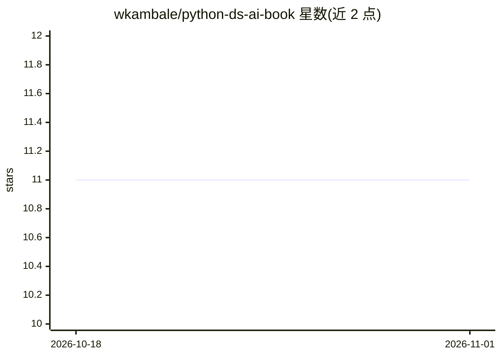

# wkambale/python-ds-ai-book

⭐ 11 · Python · MIT · 推送 2026-09-06 · [GitHub](https://github.com/wkambale/python-ds-ai-book) · [官网](https://a.co/d/04VixSbd) · 个人维护

**Python 数据科学与 AI 教科书的配套代码示例与数据集仓库**

《Python for AI and Data Science: An African Perspective》一书的配套代码库：按 17 章组织代码示例，覆盖 Python 基础、SQL、pandas、可视化、机器学习、深度学习（Keras/CNN/RNN/Transformer）、LLM 应用、MLOps、FastAPI/Docker 部署与监控，并含端到端毕业项目。示例大量使用非洲情境数据集（MobiCash 交易、农业数据、本地语言分词）。读者通过 git clone 获取代码与数据集，建议使用虚拟环境运行。书本身在 Amazon 以 Kindle 与平装形式销售。

## 筛选速览

| 维度 | 判定 | 备注 |
|---|---|---|
| AI 角色 | `ai-knowledge` | 知识聚合/清单类 |
| 许可风险 | `permissive` | MIT |
| 部署形态 | `None` |  |
| 模型依赖 | — | README 未给出锁定关系 |
| 硬件要求 | — | 无带数字的原话,不猜 |
| 安装摩擦 | `low` | 无编译、无系统依赖或容器化 |
| 成熟度 | — | 结构信号不足 |

## 能力要点

- 17 章代码示例覆盖数据科学与 AI 全流程（含 LLM 应用与 MLOps）
- 配套 datasets 目录提供书中所用数据集
- 大量采用非洲情境数据集（MobiCash、农业、本地语言分词）

## 适用场景

- 跟随书籍章节动手实践代码示例
- 学习从数据处理到模型部署与监控的完整流程
- 查阅非洲情境数据集下的数据科学案例

## 场景标签

`教程课程` · 领域:学习与行业

## 证据(README 行号)

> L3: This repository contains the complete code examples, snippets, and datasets from the book **"Python for AI and Data 
> L12: The code is organized by chapter to follow the book's learning path:

## 星数曲线

2026-10-18 11 → 2026-11-01 11（+0）

---
*卡片 v1 · prompt 1.4 · 生成 2026-11-01 · 置信度 high · 依据 README sha `4afd0df741c0` · [字段定义](../../DATASET.md)*
