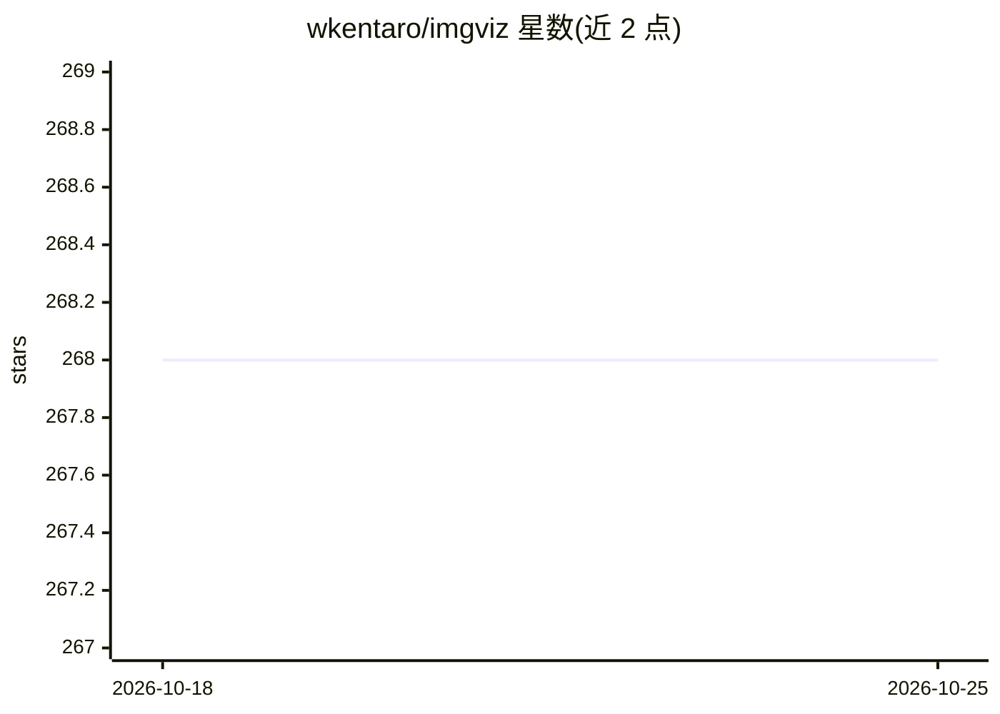

# wkentaro/imgviz

⭐ 268 · Python · MIT · 推送 2026-10-23 · [GitHub](https://github.com/wkentaro/imgviz) · 个人维护

**轻量图像可视化库：为深度学习/视觉任务提供低依赖绘图**

Python 图像可视化工具库，最小依赖仅 cmap/numpy/Pillow（不依赖 OpenCV、Matplotlib），通过 pip 安装。提供约 20 个可视化示例功能，覆盖语义/实例分割标签转 RGB、目标检测框绘制、光流转 RGB、热力图、flow/label/mask/nchannel 转 RGB、letterbox、resize、色盲友好色板等，服务于计算机视觉与深度学习结果的呈现与检查。另有 C++ 版本的说明入口。

## 筛选速览

| 维度 | 判定 | 备注 |
|---|---|---|
| AI 角色 | `ai-ecosystem` | LLM/agent 周边工具 |
| 许可风险 | `permissive` | MIT |
| 部署形态 | `library` | 以包/库形式分发 |
| 模型依赖 | — | README 未给出锁定关系 |
| 硬件要求 | — | 无带数字的原话,不猜 |
| 安装摩擦 | `low` | 无编译、无系统依赖或容器化 |
| 成熟度 | — | 结构信号不足 |

## 能力要点

- 最小依赖：仅 cmap/numpy/Pillow，不依赖 OpenCV、Matplotlib
- label2rgb/instances2rgb/mask2rgb 等分割标签可视化
- 检测框绘制、flow2rgb、heatmap 等 20 个可视化功能
- 提供 pip install imgviz[all] 一键安装全部可选依赖

## 适用场景

- 可视化语义/实例分割与目标检测的标注和预测结果
- 在不想引入 OpenCV/Matplotlib 的环境中快速绘图
- 将光流、多通道数组、标签图转为可读的 RGB 图像

## 场景标签

 · 领域:计算机视觉/图像可视化

## 证据(README 行号)

> L54:  <pre>examples/instances2rgb.py</pre>
> L56:  <pre>examples/label2rgb.py</pre>

## 星数曲线

2026-10-18 268 → 2026-10-25 268（+0）

---
*卡片 v1 · prompt 1.4 · 生成 2026-10-22 · 置信度 mid · 依据 README sha `39dc1fb5f744` · [字段定义](../../DATASET.md)*
