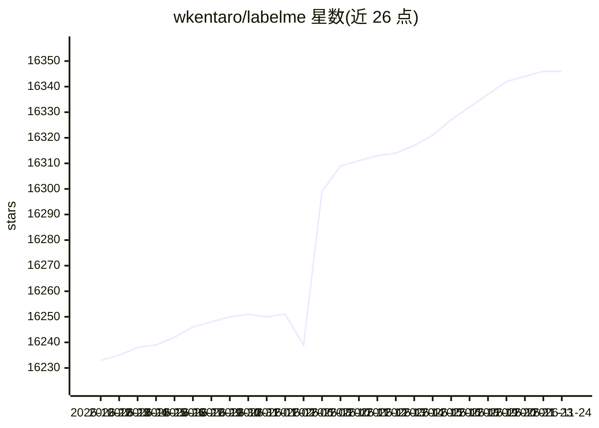

# wkentaro/labelme

⭐ 16,345 · Python · GPL-3.0 · 推送 2026-11-24 · [GitHub](https://github.com/wkentaro/labelme) · [官网](https://labelme.io) · 个人维护

**给 CV 研究者和开发者的图形化图像标注工具，含 AI 辅助标注**

用 Python 与 Qt 编写的图形图像标注工具，灵感来自 MIT labelme 项目。支持多边形、矩形、圆、线、点五类基本图元标注，以及分类 flag、视频标注；标注结果以 JSON 保存，可导出 VOC、COCO 格式数据集用于语义/实例分割。提供 21 种语言界面。v7 起使用 PySide6（Qt6），最低要求 Python 3.12 与 64 位系统；作为应用而非库发布，无稳定 Python API，稳定接口为 CLI、JSON 标注格式与配置文件。可通过 pip 安装或下载独立可执行程序（一次性付费）。

## 筛选速览

| 维度 | 判定 | 备注 |
|---|---|---|
| AI 角色 | `ai-enhanced` | 去掉 AI 部分产品仍成立 |
| 许可风险 | `viral` | GPL-3.0 |
| 部署形态 | `library` | 以包/库形式分发 |
| 模型依赖 | — | README 未给出锁定关系 |
| 硬件要求 | — | 无带数字的原话,不猜 |
| 安装摩擦 | `low` | 无编译、无系统依赖或容器化 |
| 成熟度 | — | 结构信号不足 |

## 动量与使用信号

- 维护:`active` — 距上次 push 1.8 天,年发版 34,69 位贡献者
- 涨星:近 1 天 **+4**(自 20261016 起算)
- 安装:pypi 包 `labelme` 月下载 28,719
- 平台:WINDOWS / MACOS / LINUX · 协议:—

## 能力要点

- 多边形/矩形/圆/线/点标注、分类 flag 标注与视频标注
- AI 辅助点转多边形/掩码标注（SAM、EfficientSAM），文本转标注（YOLO-world、SAM3）
- 导出 VOC 与 COCO 格式数据集
- 21 种语言界面，标注保存为 JSON

## 适用场景

- 为语义/实例分割模型制作训练数据集
- 给图像做分类标注与数据清洗
- 标注视频帧
- 用 SAM 辅助快速勾画多边形轮廓

## 场景标签

 · 领域:计算机视觉/数据标注

## 证据(README 行号)

> L12: Labelme is a graphical image annotation tool inspired by <http://labelme.csail.mit.edu>.\
> L36: - [x] AI-assisted point-to-polygon/mask annotation by SAM, EfficientSAM models

## 星数曲线

2026-10-22 16,233 → 2026-11-24 16,346（+113）

---
*卡片 v1 · prompt 1.4 · 生成 2026-11-22 · 置信度 high · 依据 README sha `30b9d5d224af` · [字段定义](../../DATASET.md)*
