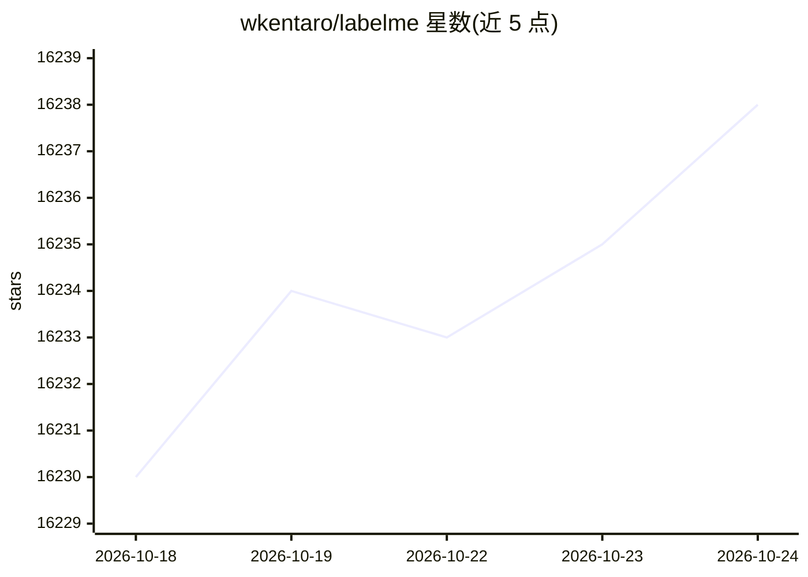

# wkentaro/labelme

⭐ 16,238 · Python · GPL-3.0 · 推送 2026-10-23 · [GitHub](https://github.com/wkentaro/labelme) · [官网](https://labelme.io) · 个人维护

**给 CV 研究者/开发者的图形化图像标注工具，含 AI 辅助标注**

用 Python 与 Qt 编写的图形图像标注工具，灵感来自 MIT labelme 项目。支持多边形、矩形、圆、线、点等图元标注，覆盖图像分类 flag、视频标注场景，可将标注导出为 VOC 或 COCO 格式数据集，标注结果以 JSON 文件保存。AI 机制方面：内置 SAM/EfficientSAM 做点到多边形/掩码辅助标注，YOLO-world/SAM3 支持文本到标注。安装途径包括 pip、独立可执行文件（付费）与 Linux 发行版包。v7 起不提供稳定 Python API，仅保证 CLI、JSON 格式与配置文件三个公开接口。

## 筛选速览

| 维度 | 判定 | 备注 |
|---|---|---|
| AI 角色 | `ai-enhanced` | 去掉 AI 部分产品仍成立 |
| 许可风险 | `viral` | GPL-3.0 |
| 部署形态 | `library` | 以包/库形式分发 |
| 模型依赖 | — | README 未给出锁定关系 |
| 硬件要求 | — | 无带数字的原话,不猜 |
| 安装摩擦 | `low` | 无编译、无系统依赖或容器化 |
| 成熟度 | — | 结构信号不足 |

## 动量与使用信号

- 维护:`active` — 距上次 push 1.8 天,年发版 34,69 位贡献者
- 涨星:近 1 天 **+4**(自 20261016 起算)
- 安装:pypi 包 `labelme` 月下载 28,719
- 平台:WINDOWS / MACOS / LINUX · 协议:—

## 能力要点

- 多图元标注：多边形、矩形、圆、线、点及分类 flag
- AI 辅助标注：SAM/EfficientSAM 点到多边形/掩码，YOLO-world/SAM3 文本到标注
- 导出 VOC/COCO 格式数据集，标注以 JSON 保存
- 支持 20 种语言界面

## 适用场景

- 为语义分割和实例分割制作训练数据集
- 给图像分类项目做图片标注与清洗
- 标注视频数据
- 用文本描述配合模型自动生成标注草稿

## 场景标签

 · 领域:计算机视觉/数据标注工具

## 证据(README 行号)

> L12: Labelme is a graphical image annotation tool inspired by <http://labelme.csail.mit.edu>.\
> L36: - [x] AI-assisted point-to-polygon/mask annotation by SAM, EfficientSAM models
> L91: - **Qt binding:** the GUI moved from PyQt5 (Qt5) to PySide6 (Qt6). `pip install labelme` now pulls PySide6 instead 

## 星数曲线

2026-10-18 16,230 → 2026-10-24 16,238（+8）

---
*卡片 v1 · prompt 1.4 · 生成 2026-10-18 · 置信度 high · 依据 README sha `4b585278f85a` · [字段定义](../../DATASET.md)*
