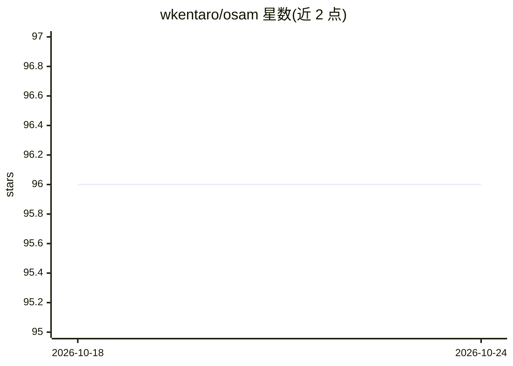

# wkentaro/osam

⭐ 96 · Python · MIT · 推送 2026-09-17 · [GitHub](https://github.com/wkentaro/osam) · 个人维护

**本地运行可提示视觉模型（SAM 系列/YOLO-World）的工具**

受 Ollama 启发的本地视觉模型运行工具：通过 `osam run` 一条命令下载并运行 SAM/SAM2/SAM3、EfficientSAM、YOLO-World 等可提示分割与检测模型，推理基于 ONNX Runtime（自动选择 CUDA/CPU 执行提供者，可配置 CoreML/DirectML/TensorRT/ROCm）。提供 CLI、Python API 与 HTTP 服务三种接口，支持托管自定义视觉模型。模型默认从官方 URL 下载，可设镜像端点并以 SHA-256 校验。以 Python 包形式安装。

## 筛选速览

| 维度 | 判定 | 备注 |
|---|---|---|
| AI 角色 | `ai-ecosystem` | LLM/agent 周边工具 |
| 许可风险 | `permissive` | MIT |
| 部署形态 | `library` | 以包/库形式分发 |
| 模型依赖 | — | README 未给出锁定关系 |
| 硬件要求 | — | 无带数字的原话,不猜 |
| 安装摩擦 | `low` | 无编译、无系统依赖或容器化 |
| 成熟度 | — | 结构信号不足 |

## 能力要点

- 一条命令下载运行 SAM1/2/3、EfficientSAM、YOLO-World 等模型
- CLI、Python、HTTP（osam serve）三种接口
- ONNX Runtime 多执行提供者支持（CUDA/CoreML/DirectML/TensorRT/ROCm）
- OSAM_BLOB_ENDPOINT 镜像下载并以 SHA-256 校验

## 适用场景

- 本地跑 SAM 系列做图像分割，不依赖云服务
- 通过 Python/HTTP 接口把分割模型嵌入自己的应用
- 在网络受限环境用镜像端点下载模型权重

## 场景标签

`目标检测` `推理引擎` · 领域:感知与多模态

## 证据(README 行号)

> L5: *Osam* (/oʊˈsɑm/) is a tool to run open-source promptable vision models locally
> L11: - **Local APIs** - CLI & Python & HTTP interface;

## 星数曲线

2026-10-18 96 → 2026-10-24 96（+0）

---
*卡片 v1 · prompt 1.4 · 生成 2026-10-23 · 置信度 high · 依据 README sha `03f75ff7aaea` · [字段定义](../../DATASET.md)*
