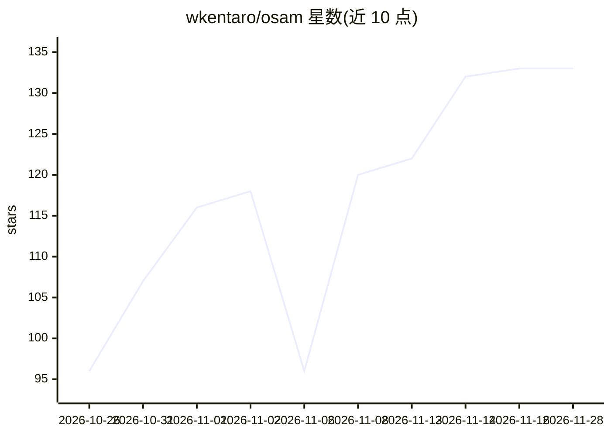

# wkentaro/osam

⭐ 133 · Python · MIT · 推送 2026-11-24 · [GitHub](https://github.com/wkentaro/osam) · 个人维护

**本地运行 SAM/SAM2/SAM3 等可提示视觉模型的 Python 库与 CLI**

Osam 是在本地运行开源可提示视觉模型（SAM、SAM2、SAM3、EfficientSAM、YOLO-World）的 Python 库与 CLI。每条命令在私有服务进程中运行模型；`osam serve` 提供可选共享服务器，其命令与 HTTP API 遵循 Ollama 风格。支持 CLI、Python 与 HTTP 三种接口，模型按需下载（支持自定义镜像端点并以 SHA-256 校验），CPU/CUDA/WebGPU/CoreML 设备可按模型选择。labelme 等应用嵌入它；SAM3 在 CUDA 上需 Python 3.11+，Linux WebGPU 需系统 Vulkan loader。

## 筛选速览

| 维度 | 判定 | 备注 |
|---|---|---|
| AI 角色 | `ai-native` | 本体是模型或模型工具 |
| 许可风险 | `permissive` | MIT |
| 部署形态 | `library` | 以包/库形式分发 |
| 模型依赖 | — | README 未给出锁定关系 |
| 硬件要求 | `cpu-ok` | |
| 安装摩擦 | `medium` | 含编译或系统依赖之一 |
| 成熟度 | — | 结构信号不足 |

## 能力要点

- 模型库含 SAM 100M–600M、SAM2 各档、SAM3、EfficientSAM、YOLO-World，CLI 一条命令下载并运行
- CLI、Python（osam.Client）与 HTTP API 三种接口，私有服务进程保持模型与图像嵌入常驻
- 支持 cpu/cuda/coreml/webgpu 执行设备与自定义 onnxruntime execution providers
- 支持视频跟踪（client.track）与非极大值抑制工具 osam.non_maximum_suppression

## 适用场景

- 在本地 CPU 或 GPU 上对图像做点/框/文本提示的分割与检测
- labelme 等标注工具嵌入本地分割模型
- 通过 osam serve 在另一台机器（如 GPU 服务器）上远程运行模型
- 对视频帧序列做 SAM3 对象跟踪

## 场景标签

`目标检测` `推理引擎` · 领域:感知与多模态

## 证据(README 行号)

> L5: *Osam* (/oʊˈsɑm/) is a Python library and CLI that runs open-source promptable
> L14: - **Promptable Vision Models** - Segment Anything Model (SAM), SAM2, SAM3, EfficientSAM, YOLO-World;
> L15: - **Local APIs** - CLI & Python & HTTP interface.

## 星数曲线

2026-10-26 96 → 2026-11-28 133（+37）

---
*卡片 v1 · prompt 1.4 · 生成 2026-11-28 · 置信度 high · 依据 README sha `1995ff8b82b6` · [字段定义](../../DATASET.md)*
