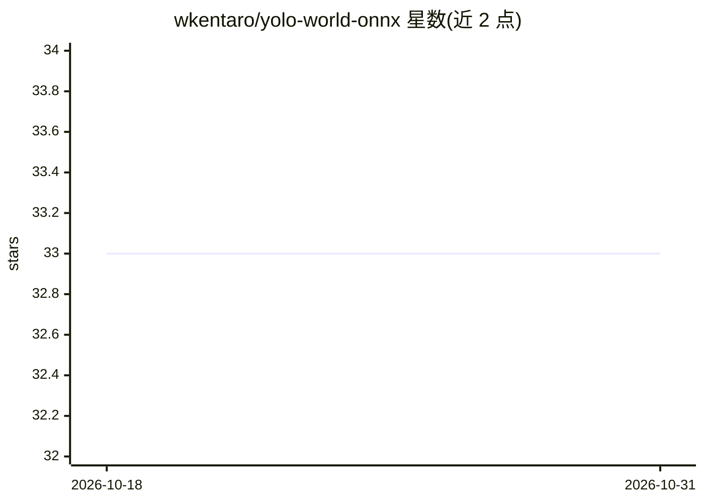

# wkentaro/yolo-world-onnx

⭐ 33 · Python · GPL-3.0 · 推送 2026-08-21 · [GitHub](https://github.com/wkentaro/yolo-world-onnx) · 个人维护

**YOLO-World 开放词汇目标检测模型的 ONNX 导出与推理工具**

提供 YOLO-World（CVPR2024 开放词汇目标检测模型）的 ONNX 格式发布工件与配套脚本：支持用 PyTorch 预训练模型推理、将 YOLO-World 与 NMS 模块导出为 ONNX、以及直接用导出的 ONNX 模型推理，可通过 --class-names 指定任意类别词表并调整 IoU/score 阈值。发布工件附 ARTIFACTS.md 记录校验和与导出输入。安装通过 make 目标完成，可选完整安装（含 PyTorch）或仅 ONNX 推理依赖。代码与 ONNX 工件以 GNU 许可分发。

## 筛选速览

| 维度 | 判定 | 备注 |
|---|---|---|
| AI 角色 | `ai-native` | 本体是模型或模型工具 |
| 许可风险 | `viral` | GPL-3.0 |
| 部署形态 | `None` |  |
| 模型依赖 | — | README 未给出锁定关系 |
| 硬件要求 | — | 无带数字的原话,不猜 |
| 安装摩擦 | `medium` | 含编译或系统依赖之一 |
| 成熟度 | — | 结构信号不足 |

## 能力要点

- 提供 YOLO-World 的 ONNX 发布工件（含校验和与导出输入记录）
- PyTorch 推理、ONNX 导出、ONNX 推理三种使用路径
- 支持 --class-names 自定义开放词汇类别与阈值参数
- 可仅安装 ONNX 推理所需依赖（make install_for_onnx）

## 适用场景

- 在无 PyTorch 环境下用 ONNX 运行 YOLO-World 目标检测
- 将 YOLO-World 与 NMS 导出为 ONNX 部署到其他运行时
- 按自定义类别词表对图片做开放词汇检测

## 场景标签

`目标检测` · 领域:感知与多模态

## 证据(README 行号)

> L30: Run inference using the PyTorch pre-trained model:
> L52: Run inference using the exported ONNX model:

## 星数曲线

2026-10-18 33 → 2026-10-31 33（+0）

---
*卡片 v1 · prompt 1.4 · 生成 2026-10-25 · 置信度 high · 依据 README sha `72738400c0b8` · [字段定义](../../DATASET.md)*
