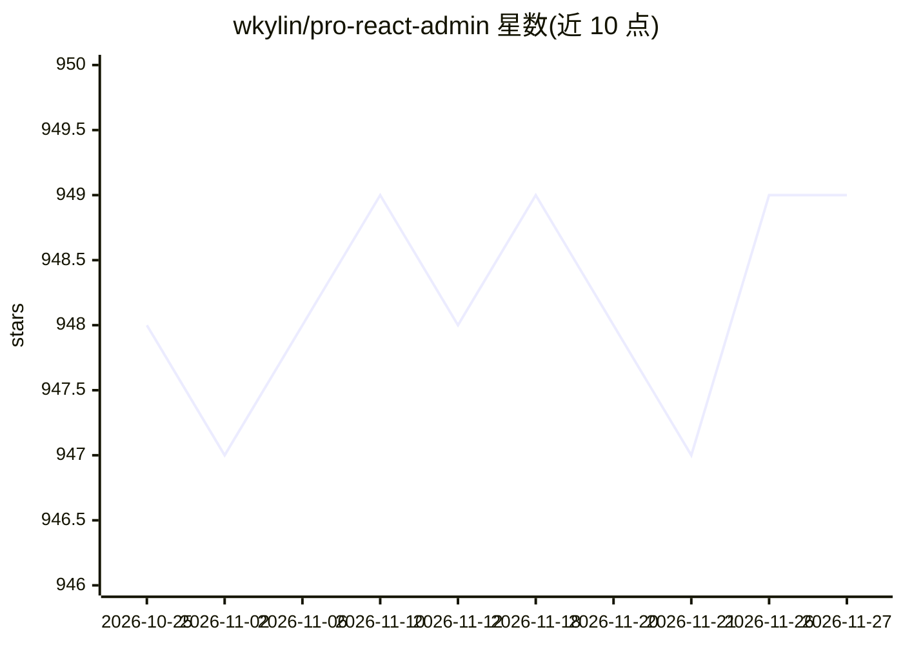

# wkylin/pro-react-admin

⭐ 949 · TypeScript · MIT · 推送 2026-11-26 · [GitHub](https://github.com/wkylin/pro-react-admin) · [官网](https://pro-react-admin.vercel.app/) · 个人维护 · 中文 README

**给 React 团队的多租户管理后台脚手架**

基于 React 19、Ant Design 6、React Router 7、Zustand 与 TypeScript 的管理后台工程底座，提供租户登录、服务端授权、角色权限与审计的 Enterprise 预设，以及查询表格、表单、详情等业务页面模板。同一份源码支持 Webpack 与 Vite 双构建，包含多项目、微前端示例和独立 UI 组件包（wui-react），配 Storybook 预览、Jest 单测与 Playwright 端到端测试。运行要求 Node.js >=24.15.0 且 <25 与 pnpm 12.16.1，通过 git clone 与 pnpm 脚本安装启动；部署路径覆盖 GitHub Pages、Vercel，真实登录可选 Neon PostgreSQL 或 SQLite。README 未描述 AI 相关功能。

## 筛选速览

| 维度 | 判定 | 备注 |
|---|---|---|
| AI 角色 | `ai-enhanced` | 去掉 AI 部分产品仍成立 |
| 许可风险 | `permissive` | MIT |
| 部署形态 | `library` | 以包/库形式分发 |
| 模型依赖 | — | README 未给出锁定关系 |
| 硬件要求 | — | 无带数字的原话,不猜 |
| 安装摩擦 | `low` | 无编译、无系统依赖或容器化 |
| 成熟度 | — | 结构信号不足 |

## 能力要点

- Enterprise 预设提供租户登录、服务端授权、用户/角色持久化与事务审计
- 同一源码支持 Webpack 与 Vite 双构建，可选多项目与微前端
- 提供查询表格、基础/分步表单、详情等业务页面模板及权限说明
- 157 个 Storybook 入口与 Jest/Playwright 测试与覆盖率报告

## 适用场景

- 为团队搭建带租户与权限体系的管理后台起点
- 参考常见业务页面模板的源码、数据 Provider 与权限策略
- 在同一工程规范下维护多个项目或微前端应用
- 构建并发布独立 UI 组件包

## 场景标签

 · 领域:前端工程化/管理后台

## 证据(README 行号)

> L5: 面向 React 团队的管理后台脚手架，提供租户权限、审计与可复用的业务页面模板。
> L32: 基于 React 19、Ant Design 6、React Router 7、Zustand 5 和 TypeScript 6。线上项目概览和工程导览展示源码、验证命令与交付边界。
> L42: 要求 Node.js >=24.15.0 且 <25、pnpm 12.16.1。

## 星数曲线

2026-10-25 948 → 2026-11-27 949（+1）

---
*卡片 v1 · prompt 1.4 · 生成 2026-11-24 · 置信度 mid · 依据 README sha `7666c19e2a60` · [字段定义](../../DATASET.md)*
