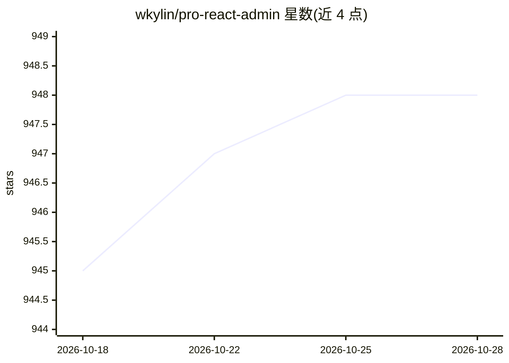

# wkylin/pro-react-admin

⭐ 948 · TypeScript · MIT · 推送 2026-10-28 · [GitHub](https://github.com/wkylin/pro-react-admin) · [官网](https://pro-react-admin.vercel.app/) · 个人维护 · 中文 README

**React 19 企业级中后台前端模板与组件库工作区**

基于 React 19、Ant Design 6、React Router 7、Zustand 5、Webpack 5 与 TypeScript 6 的多应用 monorepo：提供完整展示应用、精简企业入口、多项目构建、Module Federation 微前端（Shell/Remote），以及可独立发布到 npm 的 UI 包 @w.ui/wui-react。含可选真实租户/RBAC 后端（SQLite、会话撤销、事务审计）、Storybook 157 个组件入口、GitHub Pages/Vercel 部署流程。要求 Node.js >=24.15.0 且 <25、pnpm 11.5.2。README 未展示 AI 功能，仅主题标签含 ai/chatpgt；文档自述 SSO、多组织、分布式服务等待完善。

## 筛选速览

| 维度 | 判定 | 备注 |
|---|---|---|
| AI 角色 | `ai-enhanced` | 去掉 AI 部分产品仍成立 |
| 许可风险 | `permissive` | MIT |
| 部署形态 | `library` | 以包/库形式分发 |
| 模型依赖 | — | README 未给出锁定关系 |
| 硬件要求 | — | 无带数字的原话,不猜 |
| 安装摩擦 | `low` | 无编译、无系统依赖或容器化 |
| 成熟度 | `idea` | |

## 能力要点

- 多项目与 Module Federation 微前端（Shell + 双 Remote）构建
- 独立 UI 包 wui-react，ESM/CJS/CSS/类型声明构建并发布 npm
- 可选真实租户/RBAC 后端：SQLite 持久化、会话撤销、事务审计
- 157 个 Storybook 组件 stories 入口与生产包体积门禁

## 适用场景

- 以模板搭建企业中后台管理系统
- 通过微前端架构拆分并组合多个子应用
- 复用并发布自研 Ant Design 组件库

## 场景标签

 · 领域:Web 前端/企业管理系统

## 证据(README 行号)

> L3: React 企业管理应用与组件工作区，基于 React 19、Ant Design 6、React Router 7、Zustand 5、Webpack 5 和 TypeScript 6。提供完整展示应用、精简企业入口、多项目构建、
> L288: 工程已具备单实例自托管的租户/RBAC、持久化与事务审计基础。SSO、多组织成员关系、分布式服务、运行期插件和全仓 strict 仍需继续完善，详见架构和对标文档。

## 星数曲线

2026-10-18 945 → 2026-10-28 948（+3）

---
*卡片 v1 · prompt 1.4 · 生成 2026-10-21 · 置信度 low · 依据 README sha `050907682bad` · [字段定义](../../DATASET.md)*
