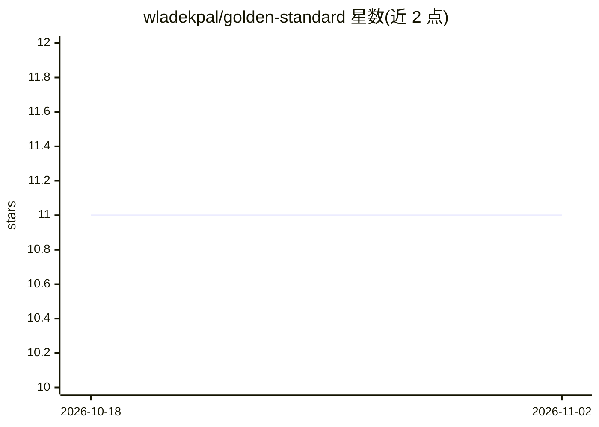

# wladekpal/golden-standard

⭐ 11 · Jupyter Notebook · 推送 2026-07-06 · [GitHub](https://github.com/wladekpal/golden-standard) · [官网](https://michalbortkiewicz.github.io/golden-standard/) · 组织维护

**论文代码库：检验 TD 与 MC 方法在 RL 拼接能力上的表现**

研究论文《Is Temporal Difference Learning the Gold Standard for Stitching in RL?》的官方代码库。实现多个 goal-conditioned RL 算法（CRL、C-Learning、GCDQN、GCIQL），为隔离拼接行为移除策略网络、直接从 Q 函数 softmax 采样动作；在 Box Moving 网格世界环境中训练与评测，并可用脚本生成专家离线数据集（支持并行采集与固定轨迹长度）。基于 JAX/uv 构建，默认集成 wandb 记录实验。仓库标注针对 GPU 优化，无 GPU 可能很慢；当前版本仅支持 box-moving 环境。

## 筛选速览

| 维度 | 判定 | 备注 |
|---|---|---|
| AI 角色 | `ai-native` | 本体是模型或模型工具 |
| 许可风险 | `none` | — |
| 部署形态 | `None` |  |
| 模型依赖 | — | README 未给出锁定关系 |
| 硬件要求 | — | 无带数字的原话,不猜 |
| 安装摩擦 | `low` | 无编译、无系统依赖或容器化 |
| 成熟度 | — | 结构信号不足 |

## 能力要点

- 实现 CRL/C-Learning/GCDQN/GCIQL 等 goal-conditioned RL 算法，移除策略网络以隔离拼接行为
- Box Moving 网格世界环境，支持可变网格尺寸、箱子数量与难度
- 专家离线数据集生成脚本，支持并行环境采集与固定轨迹长度
- 基于 uv 管理依赖，默认 wandb 实验跟踪（可用 --exp.mode disabled 跳过）

## 适用场景

- 复现论文中 TD 与 MC 方法拼接能力的对比实验
- 研究网络容量对 RL 泛化差距的影响
- 生成并使用 box-moving 专家离线数据集做 offline RL 实验

## 场景标签

`强化学习` · 领域:训练与推理

## 证据(README 行号)

> L1: # Overview 📖
> L103: We focus on goal-conditioned RL algorithms and, to isolate stitching behaviors, remove policy networks from tested

## 星数曲线

2026-10-18 11 → 2026-11-02 11（+0）

---
*卡片 v1 · prompt 1.4 · 生成 2026-11-01 · 置信度 high · 依据 README sha `ae738a883c7b` · [字段定义](../../DATASET.md)*
