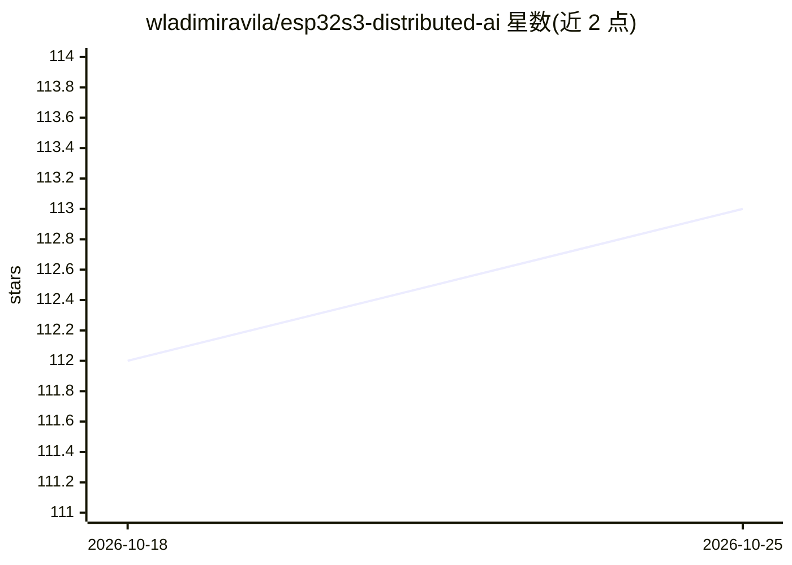

# wladimiravila/esp32s3-distributed-ai

⭐ 113 · C · 推送 2026-07-30 · [GitHub](https://github.com/wladimiravila/esp32s3-distributed-ai) · 个人维护

**在 3 块 ESP32-S3 上分布式运行 56M 参数自训练 LLM 的嵌入式项目**

端到端工程：在 WikiText-103 上训练带 Split-PLE（源自 Gemma 架构）的 56M 参数 TinyLM，4-bit 量化后拆分为三个二进制烧录到 3 块 ESP32-S3 N16R8 开发板，板间通过 ESP-NOW 无线协议协作完成自回归文本生成；Board B 在 PSRAM 维护 256 位置 KV cache，Board C 提供 WiFi AP 与网页 UI，浏览器输入 prompt 经 SSE 流式输出，全程离线。最终困惑度 192（fp32），4-bit 量化后 358，README 列出多项待完成事项（BPE C 实现、错误处理等）。面向嵌入式与边缘 AI 开发者，需自行准备硬件并烧录固件。

## 筛选速览

| 维度 | 判定 | 备注 |
|---|---|---|
| AI 角色 | `ai-native` | 本体是模型或模型工具 |
| 许可风险 | `none` | — |
| 部署形态 | `None` |  |
| 模型依赖 | — | README 未给出锁定关系 |
| 硬件要求 | — | 无带数字的原话,不猜 |
| 安装摩擦 | `low` | 无编译、无系统依赖或容器化 |
| 成熟度 | — | 结构信号不足 |

## 能力要点

- Split-PLE：50.3M 参数嵌入表拆分到两块板以适配 16MB flash
- Board B 在 PSRAM 维护 256 位置 KV cache，支持全序列注意力
- Board C 提供 WiFi AP 与 Web UI，浏览器输入 prompt 经 SSE 流式输出
- ESP-NOW 自定义协议：分片、序列号、ACK，估计往返 1–5ms

## 适用场景

- 研究微控制器上的分布式 LLM 推理架构
- 学习量化模型在嵌入式硬件上的部署流程
- 离线环境下用手机/笔记本连接开发板生成文本

## 场景标签

`模型量化` `推理引擎` · 领域:训练与推理

## 证据(README 行号)

> L3: **Distributed micro-LLM inference across three ESP32-S3 N16R8 boards with ESP-NOW communication.**
> L9: The model is trained on **WikiText-103** (Wikipedia corpus) using **Per-Layer Embeddings (PLE)** from Google's Gemma
> L39: 4. **Board C** streams the generated text to the browser via SSE (`/stream` endpoint)

## 星数曲线

2026-10-18 112 → 2026-10-25 113（+1）

---
*卡片 v1 · prompt 1.4 · 生成 2026-10-23 · 置信度 high · 依据 README sha `91a5cd1fe44a` · [字段定义](../../DATASET.md)*
